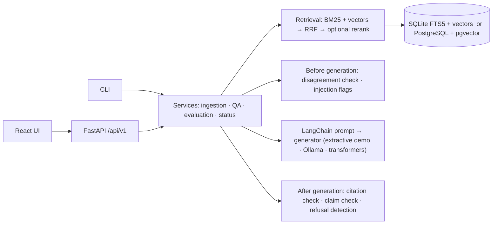

<picture>
  <source media="(prefers-color-scheme: dark)" srcset="docs/assets/banner-dark.svg">
  
</picture>

<p align="center">
  <a href="https://github.com/pouyapd/GroundedAI/actions/workflows/ci.yml"></a>
  
  
  <a href="LICENSE"></a>
  
</p>

<p align="center">
  <a href="#what-it-does">What it does</a> ·
  <a href="#how-answers-are-checked">How answers are checked</a> ·
  <a href="#quick-start">Quick start</a> ·
  <a href="#evaluation">Evaluation</a> ·
  <a href="#limitations">Limitations</a> ·
  <a href="docs/ARCHITECTURE.md">Architecture</a>
</p>

Retrieval-augmented generation (RAG) answers questions from documents, but its citations are
usually taken on trust. **GroundedAI** is a local RAG application that checks them. You upload a
PDF, ask a question, and get an answer in which every statement is compared with the passages
the model actually received: each statement found in a document comes with the exact quoted
sentence and its page, statements that are not found are marked, sources that disagree are
shown side by side, and the reply is a plain "not enough evidence" when the documents do not
say. Everything runs on a laptop CPU; no paid service or cloud API is involved.

This is a portfolio and research project, evaluated on small synthetic datasets. It has not
been independently validated, and its checks are rule-based (see [Limitations](#limitations)).

## What it does

- **Documents.** Upload PDF, text and Markdown files. Uploads are validated (type, size, magic
  bytes, encoding), split into overlapping chunks that remember their pages, and indexed for
  lexical (BM25) and vector search. Unreadable files are refused with a reason; deleting a
  document removes its chunks and stored file.
- **Questions.** Ask across all documents or only the ones you select. Hybrid retrieval (BM25 +
  embeddings, Reciprocal Rank Fusion) feeds a versioned prompt to the configured generator:
  a deterministic extractive demo (default, no model) or a local model through
  [Ollama](https://ollama.com) or transformers.
- **Checks after generation.** Citation labels are validated against the passages given to the
  model; every statement is checked against every passage and gets a status with the
  supporting quote and page; refusals and malformed replies are recognised.
- **Checks before generation.** Passages from different documents that disagree about what is
  asked are found and shown with both quotes (values for different dates or groups are kept
  apart); passages with instruction-like text are flagged and treated as data.
- **Evaluation.** Retrieval and answer benchmarks over versioned datasets, with bootstrap
  intervals and the hardware, model revision and power source recorded in every report; a
  reliability suite for the checks themselves; a blind human-review tool for claim labels.
- **Operations.** FastAPI with OpenAPI docs, SQLite or PostgreSQL + pgvector, Alembic
  migrations, health and readiness probes, Prometheus metrics, rate limits, optional API key,
  Docker image and Compose file.

<p align="center">
  
</p>
<p align="center"><sub>The running application with qwen2.5:1.5b through Ollama, on one of the sample PDFs in
<code>examples/</code>. More screenshots: <a href="docs/SCREENSHOTS.md">docs/SCREENSHOTS.md</a>.</sub></p>

## How answers are checked

Each statement of an answer gets one status. The status says whether the statement's words and
figures were **found** in a retrieved passage; it is not a judgement of truth.

| Status shown | Meaning |
|---|---|
| Supported by the cited passage | the passage the model cited contains it |
| Found in a passage, not cited | another retrieved passage contains it; GroundedAI adds that source |
| Cited the wrong passage | the cited passage does not contain it, another one does (shown instead) |
| Partly found | some of it is in a passage, not enough to count as found |
| Not found in the sources | no retrieved passage contains it |

Around the statements: *Not enough evidence* (the model or the retriever found nothing to
answer from), *Invalid model output* (no usable answer text), a disagreement panel with both
quotes when sources conflict, and warnings (wrong or invented citation labels, instruction-like
source text). The quotes are always the document's own text with character offsets; nothing is
paraphrased into a quote.

The comparison is lexical and rule-based: words (with word forms joined), figures with units,
dates, and limit words such as "at least". Two versions exist:

| | `claims-v1` (default) | `claims-v2` (opt-in, `GROUNDEDAI_CLAIM_CHECK=claims-v2`) |
|---|---|---|
| Unit of support | the whole passage (words may come from different sentences) | the few sentences of one passage that carry the statement; each extra sentence must add to it |
| Wording | word forms | word forms, a short list of equivalent phrases ("at no cost" = "free of charge"), negation compared sentence by sentence |
| Figures | numbers, money, durations, dates | also ordinals ("the 10th"), limit words, names that must appear in the evidence |
| Verdicts | one: every statement found or not | the same verdict plus separate evidence, citation and "gives what was asked" verdicts |
| Conflicts | shown with both quotes | also a warning when the answer does not mention the conflict |

`claims-v1` stays the default because the gains of `claims-v2` were measured on development
data that was also used to design it; they have not been confirmed on independent, human-labelled
data yet ([details](docs/RELIABILITY_V2.md)).

## Quick start

Requirements: Python 3.12 or 3.13, Node.js 22 or later (developed with Python 3.12.7 and
Node 24), about 1 GB of disk without models. Optional: Ollama for a local language model.

```bash
git clone https://github.com/pouyapd/GroundedAI.git && cd GroundedAI
python -m venv .venv
source .venv/bin/activate          # Windows PowerShell: .venv\Scripts\Activate.ps1
pip install -r backend/requirements/dev.txt
pip install --no-deps -e backend
cp .env.example .env               # optional: every setting has a safe default

groundedai serve                   # API on http://127.0.0.1:8000, OpenAPI docs at /docs
```

In a second terminal, start the UI and open http://localhost:5173:

```bash
cd frontend && npm ci && npm run dev
```

The database (SQLite in `./data`) is created and migrated at startup; `groundedai migrate`
runs the migrations explicitly. To serve the built UI from the API instead:
`cd frontend && npm run build`, then `GROUNDEDAI_FRONTEND_DIST=frontend/dist groundedai serve`.

**Try it.** On **Documents**, upload `examples/harbourline-ferry-guide.pdf` and
`examples/orchard-library-rules.pdf`, then press **Ask** next to the ferry guide:

- "How much does a single adult ticket to Mirrow cost?" → 14 euros, quoted from page 2.
- "How many items can members borrow?" → not enough evidence in the ferry guide; choose the
  library rules under **Search in** and ask again → 12 items.

### Default generator or a local model

Out of the box, GroundedAI uses the **extractive demo generator**, which copies sentences from
the retrieved passages. It is not a language model, needs no download, and is what the tests
use. Every answer and the UI say which generator produced it.

To answer with a real local model through Ollama:

```bash
# install Ollama from https://ollama.com, then:
ollama pull qwen2.5:1.5b           # about 1 GB; the model the evaluation used
export GROUNDEDAI_GENERATION_PROVIDER=ollama      # PowerShell: $env:GROUNDEDAI_GENERATION_PROVIDER="ollama"
export GROUNDEDAI_OLLAMA_MODEL=qwen2.5:1.5b       # default; any pulled model name works
groundedai serve
```

GroundedAI talks to Ollama at `GROUNDEDAI_OLLAMA_BASE_URL` (default `http://localhost:11434`).
If Ollama is not running or the model is not pulled, questions return `503 model_unavailable`
with the fix; GroundedAI never switches to another model on its own. The system status on the
**Operations** page shows the configured generator and whether it is available. On the
development laptop (Intel i7-1255U, no GPU) qwen2.5:1.5b takes about 18 s per answer.

Optional semantic embeddings (sentence-transformers, CPU-only PyTorch, about 1 GB more):

```bash
pip install --extra-index-url https://download.pytorch.org/whl/cpu -r backend/requirements/ml.txt
pip install --no-deps -e backend
python scripts/download_models.py --preset recommended    # asks before downloading
export GROUNDEDAI_EMBEDDING_PROVIDER=sentence-transformers GROUNDEDAI_EMBEDDING_MODEL=BAAI/bge-small-en-v1.5
```

**Docker.** `cp .env.example .env`, set `POSTGRES_PASSWORD`, then `docker compose up --build`
(PostgreSQL + pgvector + API serving the UI on http://127.0.0.1:8000). The Compose stack was last
run end to end on 2026-10-13; the current image is built and smoke-tested by CI, not re-run
locally ([docs/DEPLOYMENT.md](docs/DEPLOYMENT.md)).

### Configuration

All settings use the `GROUNDEDAI_` prefix and can be set in the environment or `.env`
([`.env.example`](.env.example) lists them; `backend/groundedai/core/config.py` documents each).

| Setting | Default | Options |
|---|---|---|
| `GENERATION_PROVIDER` | `extractive-demo` | `ollama`, `huggingface-local` |
| `OLLAMA_MODEL`, `OLLAMA_BASE_URL` | `qwen2.5:1.5b`, `http://localhost:11434` | any pulled model; a local or remote Ollama |
| `EMBEDDING_PROVIDER` | `hashing` (word overlap, no model) | `sentence-transformers`, `ollama` |
| `RETRIEVAL_MODE`, `TOP_K` | `hybrid`, `5` | `lexical`, `dense`; 1 to 50 |
| `CLAIM_CHECK` | `claims-v1` | `claims-v2` |
| `CONFLICT_CHECK` | `disagreement-v1` | `disagreement-v2`, `figures-v1` |
| `UNVERIFIED_ANSWERS` | `label` | `withhold`: return "not enough evidence" when no statement is found |
| `DATABASE_URL` | SQLite in `./data` | a PostgreSQL URL (pgvector) |
| `API_KEY`, `ENV` | none, `development` | required for `ENV=production` |

Common problems and fixes: [docs/TROUBLESHOOTING.md](docs/TROUBLESHOOTING.md).

## Using the API

```bash
curl -s http://127.0.0.1:8000/api/v1/query -H "Content-Type: application/json" \
  -d '{"question": "How much does a single adult ticket to Mirrow cost?"}'
```

The response holds the answer, `claims` (status, quotes with character offsets and pages per
statement), `verification`, `conflicts`, `sources`, `citation_check`, `warnings`, `provider`
(including `is_llm`) and `timings`. Other endpoints: upload, list, chunks, re-ingest and delete
documents; retrieval only; evaluation reports; metrics; health and readiness. Reference with a
recorded example: [docs/API.md](docs/API.md). A CLI covers the same tasks
(`groundedai ingest`, `ask`, `eval`, `serve`).

## Architecture



Upload → validate → extract text with page numbers → chunk → embed and index → retrieve →
check for disagreement and planted instructions → generate from numbered passages → validate
citations and check every statement → return the answer with quotes, pages and warnings.
Design decisions: [docs/ARCHITECTURE.md](docs/ARCHITECTURE.md).

## Evaluation

All datasets were written for this project and describe fictional organisations; the numbers
below come from small samples on one laptop and do not transfer to other domains. Full tables,
definitions and failure analysis: [docs/EVALUATION.md](docs/EVALUATION.md).

| Answer evaluation, 56 questions (qwen2.5:1.5b via Ollama, prompt answer-v2, CPU) | Result |
|---|---|
| Expected behaviour (answer or refuse) | 0.906 |
| Answerable questions answered / should-refuse questions refused | 42 of 43 / 8 of 10 |
| Key facts in the answer | 0.919 |
| Answers whose every statement was found (claims-v1 / claims-v2) | 29 / 26 of the 41 answer questions |
| Conflict questions where the model stated the conflict | 0 of 2 (the app shows both sources) |
| Answers using the required `[S#]` citation format | 30% (GroundedAI attaches the right passage itself) |

- **Retrieval.** On the 43 questions with evidence, BM25 alone reached Recall@5 0.965; hybrid
  retrieval with bge-small matched it (0.965) and no configuration was distinguishable from BM25
  (paired 95% bootstrap intervals include zero). The questions reuse the documents' wording,
  which favours lexical search.
- **The PDF journey.** A browser test drives the built UI against a real server (24 checks:
  bad files refused, the right sentence and page quoted, no answer from an unselected document,
  no stale answers after switching or deleting). It passes with the extractive generator and
  with qwen2.5:1.5b.
- **The checks themselves** were measured on a 660-case reliability suite (labels written and
  reviewed by models; a human audit of 50 labels agreed on 39, below the planned 45). On its
  frozen test split, version 2 of 2026-10-18 caught 69% of answers that miss the question
  (version 1: none) and every wrong citation, while paraphrase acceptance fell from 0.63 to
  0.51. The claims-v2 revision of 2026-10-19 has development-split results only
  ([RELIABILITY_V2.md](docs/RELIABILITY_V2.md)).
- **Human review, in progress.** A new set, `groundedai-claims-review-v1`, was written after
  the checks were frozen. Real qwen2.5:1.5b answers to its 30 questions are exported for blind
  labelling of every statement ([evaluation/reviews/claims-review-v1](evaluation/reviews/claims-review-v1/README.md)).
  No human labels exist yet, so no accuracy is claimed for it.

Reproduce: `groundedai eval retrieval --config evaluation/configs/retrieval_offline.json` (no
models, seconds), `groundedai eval generation --provider ollama --model qwen2.5:1.5b`, and the
commands in [docs/EVALUATION.md](docs/EVALUATION.md#reproducing).

## Testing

```bash
cd backend && ruff check groundedai tests && ruff format --check groundedai tests && mypy && pytest
cd frontend && npm run lint && npm run typecheck && npm test && npm run build
python scripts/dev_postgres.py -- python -m pytest backend/tests -m postgres   # real PostgreSQL, no Docker
python scripts/e2e_browser.py         # browser journey; needs playwright (not a project dependency)
python scripts/journey_check.py --out r.json   # the journey through the API with the configured model
```

The default suite is offline: SQLite, deterministic providers, and a fake Ollama HTTP server;
no model, key or network is needed. CI runs it on Python 3.12 and 3.13, plus PostgreSQL +
pgvector, the front end, a dependency audit and a Docker build and smoke test. Latest results:
[docs/TESTING.md](docs/TESTING.md).

## Privacy and security

- Local by default: the server binds to `127.0.0.1`, Compose publishes ports on `127.0.0.1`,
  and the only outbound connection is to the Ollama URL you configure. Hugging Face models are
  never downloaded implicitly (`GROUNDEDAI_HF_OFFLINE=true`).
- Uploaded files and the database stay in `./data` (or your PostgreSQL); deleting a document
  deletes its stored file and chunks. Question text is not logged unless
  `GROUNDEDAI_LOG_QUERY_TEXT=true`.
- Documents reach the model as data in a separate message; instruction-like passages are flagged
  and never count as evidence. This reduces prompt injection; it does not eliminate it.
- Before exposing the service: `GROUNDEDAI_ENV=production` and an API key of at least 24
  characters. Single-tenant: one key, no per-user permissions. Reporting and controls:
  [docs/SECURITY.md](docs/SECURITY.md).

## Limitations

- The claim check is lexical: a "found" statement can still be wrong, misleading or beside the
  question, and a correct paraphrase with other words can be "partly found". It is not an
  entailment model and no model judges the answers.
- The tested local models are small (qwen2.5:1.5b, Qwen2.5-0.5B). qwen2.5:1.5b usually gives
  the right fact, rarely uses the required citation format, never stated a conflict, and answers
  some questions it should refuse.
- The disagreement check is pattern-based: it misses conflicts that need world knowledge, can
  pair statements about different groups when a sentence does not name its group, and never
  decides which source is right.
- Evaluation data is synthetic, small and lexically easy; the reliability labels are
  model-written; human claim labels are not collected yet.
- No OCR, tables or images; English-focused text processing. A quote's page is the page on
  which it starts.

More: [docs/RELIABILITY_AUDIT.md](docs/RELIABILITY_AUDIT.md) ·
[docs/IMPLEMENTATION_STATUS.md](docs/IMPLEMENTATION_STATUS.md) ·
[CHANGELOG.md](CHANGELOG.md)

## Repository layout

```
backend/groundedai/   api · core · ingestion · retrieval · generation · services · evaluation
                      persistence (models, migrations, search) · observability · security
backend/tests/        unit · integration · api · e2e
frontend/             React 19 + TypeScript UI (src/) and static-demo data (public/demo/)
evaluation/           datasets/ · configs/ · reports/ · reviews/
examples/             two small sample PDFs with known content
scripts/              journey and browser checks, evaluation helpers, model download
docs/                 architecture, API, evaluation, security, deployment, testing
```

## Contributing and licence

Contributions are welcome; see [CONTRIBUTING.md](CONTRIBUTING.md) (setup, checks to run, how
datasets and reports are handled). Please report security problems privately
([docs/SECURITY.md](docs/SECURITY.md)).

MIT, see [LICENSE](LICENSE). Third-party packages and optional models keep their own licences:
[THIRD_PARTY_NOTICES.md](THIRD_PARTY_NOTICES.md).
