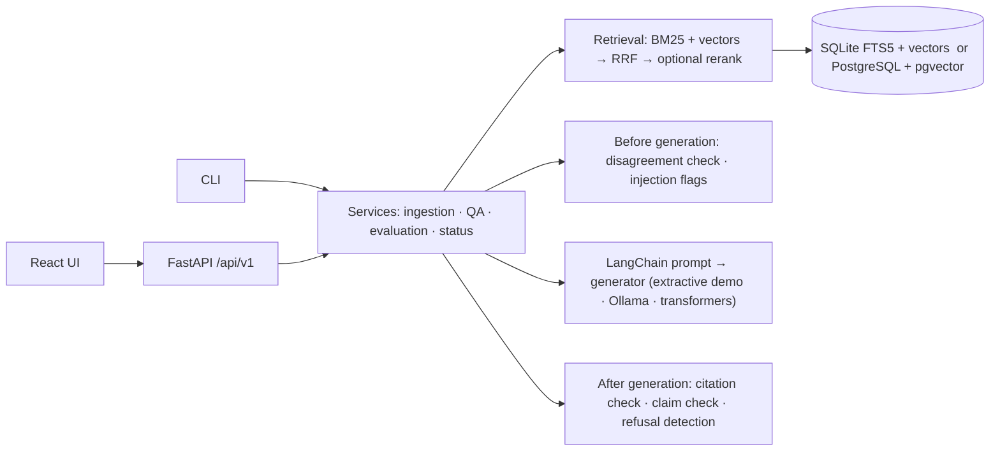

<picture>
  <source media="(prefers-color-scheme: dark)" srcset="docs/assets/banner-dark.svg">
  
</picture>

<p align="center">
  <a href="https://github.com/pouyapd/GroundedAI/actions/workflows/ci.yml"></a>
  
  
  <a href="LICENSE"></a>
  
</p>

<p align="center">
  <a href="#what-it-does">What it does</a> ·
  <a href="#engineering-challenges">Engineering challenges</a> ·
  <a href="#results">Results</a> ·
  <a href="#limitations">Limitations</a> ·
  <a href="#future-work">Future work</a> ·
  <a href="#quick-start">Quick start</a> ·
  <a href="docs/ARCHITECTURE.md">Architecture</a>
</p>

Retrieval-augmented generation (RAG) answers questions from documents, but its citations are
usually taken on trust. **GroundedAI** is a local RAG application that checks them.

- Upload a PDF, ask a question, and every statement in the answer is compared with the
  passages the model actually received.
- Statements found in a document come with the exact quoted sentence and its page; statements
  that are not found are marked.
- Sources that disagree are shown side by side.
- When the documents don't say, the reply is a plain "not enough evidence".

Everything runs on a laptop CPU, with no paid service or cloud API.

This is a portfolio and research project, evaluated on small synthetic datasets. It has not
been independently validated, and its checks are rule-based ([Limitations](#limitations)).

**Built with:** Python 3.12, FastAPI, LangChain, SQLAlchemy + Alembic, SQLite FTS5 or
PostgreSQL + pgvector, sentence-transformers, Ollama, React 19 + TypeScript (Vite), pytest,
Playwright (browser check), Docker, GitHub Actions.

## What it does

- **Documents.** PDF, text and Markdown uploads are validated (type, size, file header,
  encoding) and split into chunks that keep their page numbers. They are indexed for BM25
  and vector search. Unreadable files are refused with a reason.
- **Questions.** Ask across all documents or only selected ones. Hybrid retrieval (BM25 +
  embeddings, Reciprocal Rank Fusion) feeds a versioned prompt to one of three generators: a
  deterministic extractive demo (default, no model), a local model through
  [Ollama](https://ollama.com), or transformers.
- **Checks.** Before generation, conflicting passages and instruction-like text are flagged.
  After generation, citation labels are validated and every statement gets a status, a quote
  and a page.
- **Evaluation.** Versioned datasets and recorded model runs; every report records the
  hardware, model revision and power source. A 660-case suite tests the checks themselves,
  and recorded model outputs can be replayed through new checks.
- **Operations.** FastAPI with OpenAPI docs, SQLite or PostgreSQL + pgvector, Alembic
  migrations, health probes, Prometheus metrics, rate limits, optional API key, Docker.

<p align="center">
  
</p>
<p align="center"><sub>The running application with qwen2.5:1.5b through Ollama, on one of the sample PDFs in
<code>examples/</code>. More screenshots: <a href="docs/SCREENSHOTS.md">docs/SCREENSHOTS.md</a>.</sub></p>

## How answers are checked

Each statement gets one status. A status says whether the statement's words and figures were
**found** in a retrieved passage; it is not a judgement of truth.

| Status shown | Meaning |
|---|---|
| Supported by the cited passage | the passage the model cited contains it |
| Found in a passage, not cited | another retrieved passage contains it; GroundedAI adds that source |
| Cited the wrong passage | the cited passage does not contain it, another one does (shown instead) |
| Partly found | some of it is in a passage, not enough to count as found |
| Not found in the sources | no retrieved passage contains it |

The answer can also be *Not enough evidence* or *Invalid model output* (no usable answer text),
and it can come with warnings: conflicting sources (with both quotes), invented citation labels,
and instruction-like source text. Quotes are always the document's own text, with character
offsets.

The comparison is lexical and rule-based: word forms, figures with units, dates and limit
words such as "at least". `claims-v1` is the default. `claims-v2` is opt-in
(`GROUNDEDAI_CLAIM_CHECK=claims-v2`): it judges each statement on the few sentences that carry
it, reads equivalent wordings, ordinals and names, and compares negation sentence by sentence.
It stays opt-in because its gains were measured on development data that was also used to
design it ([details](docs/RELIABILITY_V2.md)).

## Architecture



Upload → validate → extract text with page numbers → chunk → embed and index → retrieve →
check for disagreement and planted instructions → generate from numbered passages → validate
citations and check every statement → answer with quotes, pages and warnings. Design
decisions: [docs/ARCHITECTURE.md](docs/ARCHITECTURE.md).

## Engineering challenges

| Challenge | Engineering decision | Evidence |
|---|---|---|
| **Fluent answers the sources don't support.** Model citations can't be taken on trust. | Check every statement against every passage the model received, not only the cited one. Return the exact sentence with character offsets and its page (chunks store page breaks). | 101 of 117 statements matched to an exact quote (qwen2.5:1.5b, 56-question set). The browser test checks the quoted sentence and its page. |
| **Citations in the wrong format.** qwen2.5:1.5b used the required `[S#]` labels in 30% of answers. | Separate "malformed citation" from "unsupported statement", and attach the passage that actually contains the statement. With claims-v2, bracket-only replies become *invalid output*. | No answer cited a label that does not exist; 80% of statements were cited to the passage that contains them. 17 of 47 answers still had malformed citations. |
| **Conflicts without false alarms.** The first heuristic missed both conflict questions and paired unrelated figures. | Replace it with a disagreement check measured on 30 held-out cases written before the check. It keeps values for different dates or groups apart and ignores documents that don't mention the organisation asked about. | 12 of 16 disagreements found, 0 false alarms in 14 cases (old heuristic: 6 found, 3 false alarms). |
| **False refusals.** Early runs refused answerable questions. | Diagnose before tuning: in 27 of 29 wrong refusals the evidence had been retrieved. Prompt drafts were tested only on a separate development set, under an acceptance rule fixed in advance. The next step was a larger local model, not more prompt tuning. | 56-question set: 42 of 43 answerable questions answered, 8 of 10 should-refuse questions refused. |
| **An evaluation that could grade its own work.** One author writes the checks, data and labels. | Separate development and test splits; the test split stays out of the repository, pinned by hashes and scored once per check version. Reports record commit, settings and hardware, and recorded outputs are replayed only if the rebuild reproduces them. | `claims-v2` stays opt-in. On the test split, its 2026-10-18 version caught 69% of off-target answers (`claims-v1`: none), but accepted fewer correct paraphrases (0.63 → 0.51). |
| **Local-only inference, and broken PDFs.** | Three generators behind one interface. A missing model returns `503 model_unavailable`, never a silent fallback. Scanned PDFs get an explicit no-OCR message. | The 24-check browser journey passes with the default generator and with qwen2.5:1.5b; the default test suite needs no model or network. |

Each challenge in more detail: [docs/EVALUATION.md](docs/EVALUATION.md#engineering-challenges-in-detail).

## Results

All datasets were written for this project and describe fictional organisations. Expected
behaviours and key facts were written by the project author; the reliability suite's labels
were written and reviewed by models. The numbers come from small samples on one laptop and do
not transfer to other domains.

The development set was used to develop the prompt. The 56-question evaluation set was run
once, with the frozen prompt.

| qwen2.5:1.5b via Ollama, CPU, default checks | Development set (25) | Evaluation set (56) |
|---|---|---|
| Answer questions: correct, every statement verified | 13 of 19 | 29 of 41 |
| — correct facts, not every statement verified | 3 | 10 |
| — partly correct / wrong | 1 / 0 | 0 / 1 |
| — false refusals | 2 | 1 |
| Should refuse: refused / answered anyway | 5 / 1 | 8 / 2 |
| Conflict questions: conflict stated by the model | 0 of 2 | 0 of 2 |
| Answers with malformed citations | 6 of 18 | 17 of 47 |
| Correct and fully verified with `claims-v2` (opt-in) | 14 of 19 | 26 of 41 (replay) |
| Median time per answer | 21 s | 18 s |

- **"Correct"** means the answer contains every key fact. **"Not every statement verified"**
  usually means that an extra sentence or a paraphrase was not matched to a passage. It is
  counted apart from wrong answers.
- **Conflict questions:** the development column counts its 2 among the 19 answer questions;
  the evaluation column counts them separately.
- **The `claims-v2` replay** re-checks the recorded answers without calling the model.
- **Retrieval:** on the development set, the evidence was among the 5 passages for all 19
  answerable questions, so both false refusals came from the model.
- **Retrieval (evaluation set):** on its 43 questions with evidence, BM25 alone reached
  Recall@5 0.965. Hybrid retrieval with bge-small matched it, and no configuration was
  distinguishable from BM25. The questions reuse the documents' wording, which favours
  lexical search.
- **Why the behaviours are scored separately:** a correct answer can carry an unsupported
  sentence, a supported statement can cite the wrong passage, and a refusal can be right or
  wrong. The fixes differ too (retrieval, prompt or model, claim check, conflict check), so a
  single combined score would hide which part failed.

Full tables and methodology: [docs/EVALUATION.md](docs/EVALUATION.md). Reproduce:
[docs/EVALUATION.md#reproducing](docs/EVALUATION.md#reproducing).

## Limitations

- **The claim check is lexical, not an entailment model.** A "found" statement can still be
  wrong or beside the question, and a correct paraphrase can be "partly found". Known misses:
  - a true statement about something other than what was asked;
  - a rate whose unit differs ("£1 per minute" accepted for "£1 per 15 minutes").
- **The tested local models are small** (qwen2.5:1.5b, Qwen2.5-0.5B). qwen2.5:1.5b usually
  gives the right fact, but rarely uses the required citation format, has never stated a
  conflict, and answers some questions it should refuse.
- **The disagreement check is pattern-based.** It misses conflicts that need world knowledge,
  can pair statements about different groups when a sentence doesn't name its group, and
  never decides which source is right.
- **The evaluation data is synthetic, small and lexically easy.** GroundedAI does not
  eliminate hallucinations or guarantee that an answer is correct.
- **No OCR, tables or images;** text processing is English-focused. A quote's page is the
  page on which it starts.

## Future work

1. **Benchmark more local models under the same conditions**, for example Mistral 7B through
   the existing Ollama provider. The datasets, settings, checks and scoring stay the same, so
   the comparison is fair. The development-set errors point mostly at the model (refusals,
   citation format, unstated conflicts).
2. **Improve claim-level verification and citation quality**: off-topic true statements, rate
   units, strict paraphrase handling and malformed citations. The method is error analysis on
   development data, with changes confirmed on a new held-out set.
3. **Improve conflict detection and refusals**: find conflicts stated in words rather than
   figures, and reduce false refusals (2 of 19 on the development set) without answering
   unanswerable questions (1 of 6 answered).
4. **Expand regression tests** with the failure cases observed in model runs. Bug fixes already
   come with regression tests ([CONTRIBUTING.md](CONTRIBUTING.md)).
5. **Compare models on answer quality, verification coverage, latency and memory**, and
   publish the results next to the qwen2.5:1.5b figures once they have been measured.

## Quick start

Requirements: Python 3.12 or 3.13, Node.js 22 or later, and about 1 GB of disk without
models. Ollama is optional.

```bash
git clone https://github.com/pouyapd/GroundedAI.git && cd GroundedAI
python -m venv .venv
source .venv/bin/activate          # Windows PowerShell: .venv\Scripts\Activate.ps1
pip install -r backend/requirements/dev.txt
pip install --no-deps -e backend
cp .env.example .env               # optional: every setting has a safe default
groundedai serve                   # API on http://127.0.0.1:8000, OpenAPI docs at /docs
```

In a second terminal: `cd frontend && npm ci && npm run dev`, then open http://localhost:5173.
The SQLite database in `./data` is created and migrated at startup.

**Try it.** On **Documents**, upload `examples/harbourline-ferry-guide.pdf` and
`examples/orchard-library-rules.pdf`, then press **Ask** next to the ferry guide:

- "How much does a single adult ticket to Mirrow cost?" → 14 euros, quoted from page 2.
- "How many items can members borrow?" → not enough evidence in the ferry guide. Choose the
  library rules under **Search in** and ask again → 12 items.

**A local model.** The default extractive generator copies sentences from the passages; it is
not a language model and needs no download. To answer with a local model instead:

```bash
ollama pull qwen2.5:1.5b                          # about 1 GB; install Ollama from https://ollama.com
export GROUNDEDAI_GENERATION_PROVIDER=ollama      # PowerShell: $env:GROUNDEDAI_GENERATION_PROVIDER="ollama"
groundedai serve
```

If Ollama or the model is missing, questions return `503 model_unavailable` with the fix.
Optional semantic embeddings: [docs/MODELS.md](docs/MODELS.md). Docker Compose (PostgreSQL +
pgvector): [docs/DEPLOYMENT.md](docs/DEPLOYMENT.md). Common problems:
[docs/TROUBLESHOOTING.md](docs/TROUBLESHOOTING.md).
The Compose stack was last run end to end on 2026-10-13; the image was not rebuilt locally
for this release.

### Configuration

All settings use the `GROUNDEDAI_` prefix ([`.env.example`](.env.example) lists them).

| Setting | Default | Options |
|---|---|---|
| `GENERATION_PROVIDER` | `extractive-demo` | `ollama`, `huggingface-local` |
| `OLLAMA_MODEL`, `OLLAMA_BASE_URL` | `qwen2.5:1.5b`, `http://localhost:11434` | any pulled model; a local or remote Ollama |
| `EMBEDDING_PROVIDER` | `hashing` (word overlap, no model) | `sentence-transformers`, `ollama` |
| `RETRIEVAL_MODE`, `TOP_K` | `hybrid`, `5` | `lexical`, `dense`; 1 to 50 |
| `CLAIM_CHECK` | `claims-v1` | `claims-v2` |
| `CONFLICT_CHECK` | `disagreement-v1` | `disagreement-v2`, `figures-v1` |
| `UNVERIFIED_ANSWERS` | `label` | `withhold`: return "not enough evidence" when no statement is found |
| `DATABASE_URL` | SQLite in `./data` | a PostgreSQL URL (pgvector) |
| `API_KEY`, `ENV` | none, `development` | required for `ENV=production` |

The HTTP API (`POST /api/v1/query` and the document, retrieval, evaluation and health
endpoints) is documented in [docs/API.md](docs/API.md); a CLI covers the same tasks.

## Testing

```bash
cd backend && ruff check groundedai tests && ruff format --check groundedai tests && mypy && pytest
cd frontend && npm run lint && npm run typecheck && npm test && npm run build
python scripts/dev_postgres.py -- python -m pytest backend/tests -m postgres   # real PostgreSQL, no Docker
python scripts/e2e_browser.py      # browser journey; needs playwright (not a project dependency)
```

The default suite is offline: SQLite, deterministic providers and a fake Ollama HTTP server.
No model, key or network is needed.

- **Latest local run (2026-10-19):**
  - backend: 475 tests passed, plus 7 PostgreSQL tests run separately against a local
    PostgreSQL + pgvector; strict mypy and ruff clean;
  - front end: 70 tests passed;
  - browser journey: 24 of 24, with the default generator and with qwen2.5:1.5b.
- **CI** (Python 3.12 and 3.13, PostgreSQL, front end, dependency audit, Docker build) has
  not yet run on the latest commits.

Details: [docs/TESTING.md](docs/TESTING.md).

## Privacy and security

- **Local by default.** The server binds to `127.0.0.1`, and the only outbound connection is
  to the Ollama URL you configure. Models are never downloaded implicitly.
- **Your files stay in `./data`** (or your PostgreSQL). Deleting a document deletes its file
  and chunks. Question text is not logged unless you enable it.
- **Prompt injection is reduced, not prevented.** Documents reach the model as data, and
  instruction-like passages are flagged and never count as evidence.
- **Single-tenant.** One API key, no per-user permissions.

Details: [docs/SECURITY.md](docs/SECURITY.md).

## Repository layout

```
backend/groundedai/   api · core · ingestion · retrieval · generation · services · evaluation
                      persistence (models, migrations, search) · observability · security
backend/tests/        unit · integration · api · e2e
frontend/             React 19 + TypeScript UI (src/) and static-demo data (public/demo/)
evaluation/           datasets/ · configs/ · reports/ · reviews/
examples/             two small sample PDFs with known content
scripts/              journey and browser checks, evaluation helpers, model download
docs/                 architecture, API, evaluation, security, deployment, testing
```

More: [CHANGELOG.md](CHANGELOG.md) · [docs/IMPLEMENTATION_STATUS.md](docs/IMPLEMENTATION_STATUS.md) ·
[docs/RELIABILITY_AUDIT.md](docs/RELIABILITY_AUDIT.md)

## Contributing and licence

Contributions are welcome: see [CONTRIBUTING.md](CONTRIBUTING.md). Please report security
problems privately ([docs/SECURITY.md](docs/SECURITY.md)). MIT licence ([LICENSE](LICENSE));
third-party packages and models keep their own licences
([THIRD_PARTY_NOTICES.md](THIRD_PARTY_NOTICES.md)).
