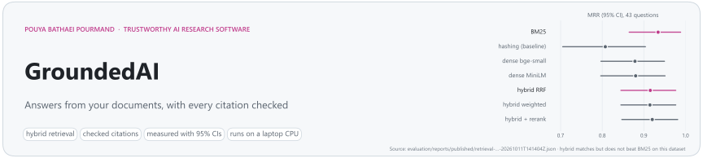
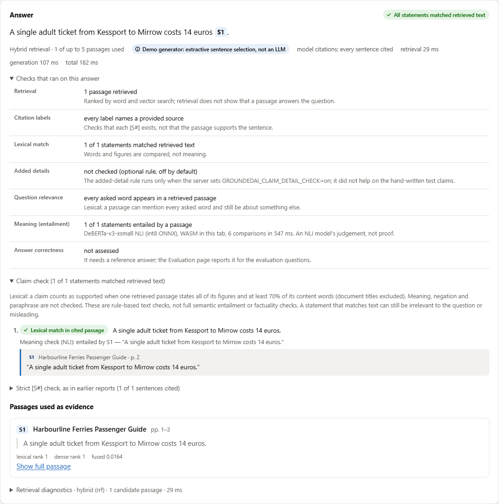
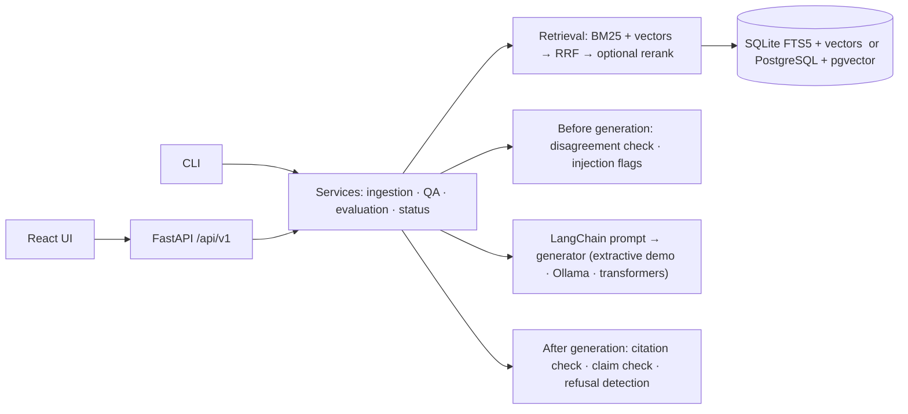

<picture>
  <source media="(prefers-color-scheme: dark)" srcset="docs/assets/banner-dark.svg">
  
</picture>

<p align="center">
  <a href="https://github.com/pouyapd/GroundedAI/actions/workflows/ci.yml"></a>
  
  
  <a href="LICENSE"></a>
</p>

# GroundedAI

**Ask questions about your PDFs and get answers whose evidence you can check: every statement comes with the exact quote and page it rests on, and with a list of the checks that ran and what they found.**

<p align="center">
  <a href="https://pouyapd.github.io/GroundedAI/"></a>
</p>

The [live demo](https://pouyapd.github.io/GroundedAI/) is the real application running in your
browser tab (Python compiled to WebAssembly). No account and no server: what you type or upload
stays in the tab.

<p align="center">
  
</p>
<p align="center"><sub>A screenshot of the deployed demo (2026-11-15) with the optional meaning check switched on.</sub></p>

**What it does**

- **Evidence for each statement:** the supporting sentence, quoted exactly, with its page and source label.
- **Separate checks, never one score:** retrieval, citation labels, lexical match, question relevance and, optionally, added details (a
  lexical rule, off by default) and meaning (an NLI model) are shown as separate rows. Answer
  correctness is never claimed.
- **Refusals that say why:** when the passages do not mention what the question asks about, the
  extractive generator says which words are missing instead of answering.
- **Disagreements between sources:** two documents, or two editions of one document, that state
  different values or requirements are shown with both quotes, editions and pages. GroundedAI
  does not decide which one is right.
- **Local-first:** a deterministic extractive generator, a local model through Ollama or
  transformers, or Qwen2.5-1.5B on your GPU in the browser. No paid API is needed.
- **Operations:** FastAPI, SQLite or PostgreSQL + pgvector, migrations, safe re-indexing after a
  settings change, health checks, metrics, Docker, CI.

> **Important:** a checked citation is not a correct answer. The default claim check compares
> words and figures; the optional NLI check is a model's judgement, not proof. Open the source
> before relying on an answer. This is a research and portfolio prototype, evaluated on small
> datasets written mostly by its author.

**Built with:** Python 3.12, FastAPI, LangChain, SQLAlchemy + Alembic, SQLite FTS5 or
PostgreSQL + pgvector, sentence-transformers, Ollama, React 19 + TypeScript (Vite), Pyodide,
WebLLM, ONNX Runtime Web, pytest, Playwright, Docker, GitHub Actions.

<p align="center">
  <a href="#status">Status</a> ·
  <a href="#live-demo">Live demo</a> ·
  <a href="#architecture">Architecture</a> ·
  <a href="#how-a-question-is-answered">Pipeline</a> ·
  <a href="#results">Results</a> ·
  <a href="#limitations">Limitations</a> ·
  <a href="#engineering-challenges">Engineering challenges</a> ·
  <a href="#quick-start">Quick start</a> ·
  <a href="#future-work">Future work</a>
</p>

## Status

| | |
|---|---|
| **Implemented and tested** | upload checks and PDF extraction with pages; hybrid retrieval (BM25 + vectors, RRF); three generators; citation-label check; lexical claim check with exact quotes; optional added-detail flag (off by default); question-relevance check and refusal (extractive); disagreement check across documents and editions; safe bulk re-indexing; browser demo with an optional in-page language model and an optional NLI meaning check |
| **Evaluated** | synthetic sets (development, 56-question evaluation, 30 held-out conflict cases); real NIST PDFs (53 test questions, 108 hand-written test claims, validation and fictional-edition sets), each change compared with the previous defaults ([round 3](docs/RELIABILITY_V3.md), [round 2](docs/RESEARCH_EVALUATION.md)) |
| **Incomplete** | LoRA fine-tuning of the answer model: prepared and smoke-tested, not trained (no GPU); the meaning check is not part of the server API |
| **Known weaknesses** | real version changes between two NIST editions are still missed (0 of 4); the extractive relevance check refuses too many answerable test questions (10 of 40); small, single-author datasets ([all limitations](#limitations)) |

## Live demo

**[Open the live demo →](https://pouyapd.github.io/GroundedAI/)**

- **The real backend, in your browser.** GroundedAI's Python code runs as WebAssembly
  (Pyodide): upload checks, PDF extraction, hybrid retrieval, the prompt and every check. Two
  synthetic sample PDFs are loaded, with example questions; you can also upload a PDF.
- **Two answer generators.** The *extractive* generator selects sentences from the retrieved
  passages by word matching; it is deterministic, instant and not a language model, and refuses
  when the passages do not mention what is asked. The optional *Qwen2.5-1.5B-Instruct* runs on
  your GPU through WebLLM and WebGPU (about 880 MB once, then cached); it handles freer wording
  but can still be wrong. Both go through the same checks.
- **Optional meaning check.** An NLI model (DeBERTa-v3-xsmall, int8 ONNX) runs on your CPU with
  ONNX Runtime Web (about 111 MB once, then cached; about 0.6 GB of memory while on). It marks
  each statement as entailed, contradicted or not entailed by the closest passage sentences.
- **Limits.** The first load takes about 15–60 s. The demo uses a hashing embedder (word
  overlap, not meaning); data stays in the tab and is gone after a reload. Details:
  [docs/ONLINE_DEMO.md](docs/ONLINE_DEMO.md).

## How answers are checked

Each statement gets one status. By default, the claim checker asks whether the statement's words and figures were **found** in a retrieved passage. This is lexical evidence matching, not semantic entailment, factual validation or a check that the answer addresses the question.

| Status shown | Meaning |
|---|---|
| Lexical match in cited passage | the cited passage meets the rule-based word-and-figure overlap threshold |
| Passage matched, not cited by model | another retrieved passage meets the threshold; GroundedAI attaches that evidence |
| Lexical match in another passage | the model's cited passage did not match, but another retrieved passage did |
| Partial lexical match | some statement content overlaps, but the passage does not meet the threshold |
| No lexical match in retrieved passages | no retrieved passage meets the matching rule |

The answer can also be *Not enough evidence* or *Invalid model output* (no usable answer text),
and it can come with warnings: conflicting sources (with both quotes), invented citation labels,
and instruction-like source text. Quotes are always the document's own text, with character
offsets.

The comparison is lexical and rule-based: word forms, figures with units, dates and limit
words such as "at least". `claims-v1` is the default. `claims-v2` is opt-in
(`GROUNDEDAI_CLAIM_CHECK=claims-v2`): it judges each statement on the few sentences that carry
it, reads equivalent wordings, ordinals and names, and compares negation sentence by sentence.
It stays opt-in because its gains were measured on development data that was also used to
design it ([details](docs/RELIABILITY_V2.md)).

## Architecture



Upload → validate → extract text with page numbers → chunk → embed and index → retrieve →
check for disagreement and planted instructions → generate from numbered passages → validate
citations and check every statement → answer with quotes, pages and warnings. Design
decisions: [docs/ARCHITECTURE.md](docs/ARCHITECTURE.md).

The [live demo](docs/ONLINE_DEMO.md) runs this same application in the browser: the UI sends
its requests to a Web Worker running the Python package in Pyodide instead of a server, and the
optional model runs on the visitor's GPU with WebLLM.

## How a question is answered

| Stage | What happens | Measured (see [Results](#results)) |
|---|---|---|
| **Upload** | Type, size (10 MB), file header and encoding are checked; unreadable or scanned PDFs are refused with a reason. | Damaged, scanned, empty and oversized files refused on the live demo. |
| **Text extraction** | pypdf extracts each page's text. Text clean-up `v2` (default) expands ligatures, joins words hyphenated at line ends, and removes running headers, footers and page numbers that repeat at page edges. Each page keeps its own text, so page numbers do not move. | On 10 NIST PDFs only layout text was removed (one repeated table header too); all quotes stayed verbatim and on the right page. |
| **Chunking** | LangChain's recursive splitter, 800 characters with 120 overlap; every chunk records its first and last page and the page breaks inside it. | 400 and 1,200 characters were tested; 800 kept. |
| **Indexing and retrieval** | BM25 (SQLite FTS5, Porter stemming) and vector search (hashing embedder by default, or sentence-transformers), fused with Reciprocal Rank Fusion (k = 60); top 5 passages, optional cross-encoder reranking; PostgreSQL + pgvector as an alternative store. | Recall@5 of the evidence page .864 on the real-PDF test set. A reranker reached 1.0 on validation but was 25 to 140 times slower. |
| **Before generation** | Passages that state different values for the same thing are paired (disagreement check). Two editions of one document (found from their titles) are compared statement by statement, by value and by SHALL/SHOULD wording; if only one edition was retrieved, the other's best passages are added. Instruction-like text in a passage is flagged and passed as data. | Synthetic held-out set: 12 of 16 disagreements found, 0 false alarms. Fictional editions: 10 of 11 (dev), 4 of 7 (validation, first run). Real version changes: 0 of 4 found. |
| **Generation** | A versioned LangChain prompt with numbered passages `[S1]`...; the model must cite or reply `INSUFFICIENT_EVIDENCE`. Generators: extractive (default, no model; copies the best-matching sentences, and refuses when an asked word appears in no passage), a local model through Ollama, transformers, or Qwen2.5-1.5B in the browser (WebLLM). | Correct answers on the real-PDF test set: extractive .625 (with the relevance check; .725 without), qwen2.5:1.5b .775. |
| **After generation** | Citation labels are checked against the passages actually given; every statement is matched to the passages (lexical claim check) and gets a status, the exact quote and its page; optionally (off by default), words a statement adds that no passage contains are flagged; partial answers before a refusal marker are checked too. In the browser demo, an NLI model can check meaning as a second, separate opinion. | Invented labels (such as `S2` when only `S1` was given) are flagged. On 108 hand-written test claims: lexical check macro-F1 .388, NLI (int8, as in the browser) .716. |

The server's claim check compares words and figures, not meaning: it cannot tell a
contradiction from a missing fact. The NLI meaning check does much better on hand-written claims
(macro-F1 .716 against .388), but it runs only in the browser demo, as an optional second
opinion, and it is still a model's judgement.

## Engineering challenges

| Challenge | Engineering decision | Evidence |
|---|---|---|
| **Fluent answers the sources don't support.** Model citations can't be taken on trust. | Check every statement against every passage the model received, not only the cited one. Return the exact sentence with character offsets and its page (chunks store page breaks). | 101 of 117 statements matched to an exact quote (qwen2.5:1.5b, 56-question set). The browser test checks the quoted sentence and its page. |
| **Citations in the wrong format.** qwen2.5:1.5b used the required `[S#]` labels in 30% of answers. | Separate "malformed citation" from "unsupported statement", and attach the passage that actually contains the statement. With claims-v2, bracket-only replies become *invalid output*. | No answer cited a label that does not exist; 80% of statements were cited to the passage that contains them. 17 of 47 answers still had malformed citations. |
| **Conflicts without false alarms.** The first heuristic missed both conflict questions and paired unrelated figures. | Replace it with a disagreement check measured on 30 held-out cases written before the check. It keeps values for different dates or groups apart and ignores documents that don't mention the organisation asked about. | 12 of 16 disagreements found, 0 false alarms in 14 cases (old heuristic: 6 found, 3 false alarms). |
| **False refusals.** Early runs refused answerable questions. | Diagnose before tuning: in 27 of 29 wrong refusals the evidence had been retrieved. Prompt drafts were tested only on a separate development set, under an acceptance rule fixed in advance. The next step was a larger local model, not more prompt tuning. | 56-question set: 42 of 43 answerable questions answered, 8 of 10 should-refuse questions refused. |
| **An evaluation that could grade its own work.** One author writes the checks, data and labels. | Separate development and test splits; the test split stays out of the repository, pinned by hashes and scored once per check version. Reports record commit, settings and hardware, and recorded outputs are replayed only if the rebuild reproduces them. | `claims-v2` stays opt-in. On the test split, its 2026-10-18 version caught 69% of off-target answers (`claims-v1`: none), but accepted fewer correct paraphrases (0.63 → 0.51). |
| **Changing the text pipeline without breaking the index.** Text clean-up v2 became the default, but documents indexed before kept v1 text, and re-ingesting could delete a stored file. | Record how each document was indexed and compare it with the current settings; rebuild outdated documents one at a time, swap chunks in one transaction under a row lock, keep the old index on any failure. | Tests for equality with a fresh ingestion, failures at every step, concurrent changes, a stopped job and a restart, on SQLite and PostgreSQL. |
| **Local-only inference, and broken PDFs.** | Three generators behind one interface. A missing model returns `503 model_unavailable`, never a silent fallback. Scanned PDFs get an explicit no-OCR message. | The 24-check browser journey passes with the default generator and with qwen2.5:1.5b; the default test suite needs no model or network. |

Each challenge in more detail: [docs/EVALUATION.md](docs/EVALUATION.md#engineering-challenges-in-detail).

## Results

There are two groups of results: synthetic documents (below) and
[real PDFs](#real-pdfs-november-2026). They use different documents and questions and are not
combined.

The synthetic datasets were written for this project and describe fictional organisations.
Expected behaviours and key facts were written by the project author; the reliability suite's
labels were written and reviewed by models. The numbers come from small samples on one laptop
and do not transfer to other domains.

The development set was used to develop the prompt. The 56-question evaluation set was run
once, with the frozen prompt.

| qwen2.5:1.5b via Ollama, CPU, default checks | Development set (25) | Evaluation set (56) |
|---|---|---|
| Answer questions: correct, every statement verified | 13 of 19 | 29 of 41 |
| — correct facts, not every statement verified | 3 | 10 |
| — partly correct / wrong | 1 / 0 | 0 / 1 |
| — false refusals | 2 | 1 |
| Should refuse: refused / answered anyway | 5 / 1 | 8 / 2 |
| Conflict questions: conflict stated by the model | 0 of 2 | 0 of 2 |
| Answers with malformed citations | 6 of 18 | 17 of 47 |
| Correct and fully verified with `claims-v2` (opt-in) | 14 of 19 | 26 of 41 (replay) |
| Median time per answer | 21 s | 18 s |

- **"Correct"** means the answer contains every key fact. **"Not every statement verified"**
  usually means that an extra sentence or a paraphrase was not matched to a passage. It is
  counted apart from wrong answers.
- **Conflict questions:** the development column counts its 2 among the 19 answer questions;
  the evaluation column counts them separately.
- **The `claims-v2` replay** re-checks the recorded answers without calling the model.
- **Retrieval:** on the development set, the evidence was among the 5 passages for all 19
  answerable questions, so both false refusals came from the model.
- **Retrieval (evaluation set):** on its 43 questions with evidence, BM25 alone reached
  Recall@5 0.965. Hybrid retrieval with bge-small matched it, and no configuration was
  distinguishable from BM25. The questions reuse the documents' wording, which favours
  lexical search.
- **Why the behaviours are scored separately:** a correct answer can carry an unsupported
  sentence, a supported statement can cite the wrong passage, and a refusal can be right or
  wrong. The fixes differ too (retrieval, prompt or model, claim check, conflict check), so a
  single combined score would hide which part failed.

Full tables and methodology: [docs/EVALUATION.md](docs/EVALUATION.md). Reproduce:
[docs/EVALUATION.md#reproducing](docs/EVALUATION.md#reproducing).

### Real PDFs (November 2026)

Ten public NIST publications, split by document: three for testing (two versions of SP 800-63B
and the AI Risk Management Framework), two for choosing settings, five for training data. The
53 test questions and the 108 test claims were written by hand before any run; settings were
chosen on the validation documents and each configuration was run once on the test set. One
laptop CPU, no GPU, no paid service. Differences are given with paired bootstrap 95% intervals;
with 40 answerable questions, one question is 2.5 points.

**End-to-end answers** (53 questions, 40 answerable):

| | Extractive generator | qwen2.5:1.5b (Ollama) |
|---|---|---|
| Recall@5 / MRR@10 of the evidence pages, old defaults | .807 / .753 | same retrieval |
| Correct answers, old defaults (`TEXT_CLEANUP=v1`, `EXTRACTIVE_MATCHING=exact`) | .600 | .750 |
| Correct answers, with `TEXT_CLEANUP=v2` and `EXTRACTIVE_MATCHING=prefix` (the new defaults) | .725 (+.125, CI +.025 to +.250) | .775 (+.025, CI -.100 to +.150) |
| Recall@5 / MRR@10 with those settings | .864 / .792 (+.057, CI .000 to +.136 / +.038, CI -.003 to +.094) | same retrieval |
| Should refuse (6): refused, old defaults / new defaults | 2 / 1 | 6 / 5 |
| Answers without a valid source label, old defaults | 0 of 46 | 28 of 45 |
| Quotes verbatim and on the right page | all | all |
| Version conflicts reported (4) | 0 | 0 |
| Median time per question | 0.1 s | 22 s |

**Reliability round 3** (November 2026; old defaults against new defaults at the same
commit, test sets run once after the defaults were fixed; details in
[docs/RELIABILITY_V3.md](docs/RELIABILITY_V3.md)):

| Change | Validation data | Protected test set |
|---|---|---|
| Version-aware disagreement (`disagreement-v3`) | fictional editions: 10 of 11 found (dev, v1: 5), 4 of 7 (validation, first run; v1: 1); no false alarm | real version changes: still 0 of 4; no false alarm in 49 questions |
| Relevance check and refusal, extractive (`extractive_relevance=v2`) | refused 20 of 20 questions to refuse (was 8); false refusals 7 of 46 (was 1); correct answers unchanged (32 of 46) | refused 4 of 6 (was 1; t38 fixed); correct .625 (was .725; paired −.100, CI −.225 to 0); false refusals 10 of 40 (was 3) |
| Added-detail flag (`claim_detail_check`; optional, off by default since 2026-11-15) | fewer false "supported" on fictional and rule-made claims (.294 → .118; .242 → .158) | no gain on the 108 test claims; 3 more correct claims flagged; therefore made optional |
| NLI meaning check in the browser (int8 ONNX) | validation answers: 1 of 1 wrong answer caught, 5 of 15 correct ones flagged (lexical: 6) | test claims macro-F1 .716 (lexical .388); wrong qwen2.5:1.5b answers caught 5 of 9 (lexical 1), correct ones flagged 6 of 30 (lexical 4); wrong extractive answers caught 0 of 7 |
| Browser cost of the meaning check (laptop CPU) | local build on mains power: about 96 ms per statement-sentence pair, 1.1–1.3 s start from the cache, about 0.6 GB of memory while on | deployed site: works the same (159 of 160 labels as in Python, 93 MB on first use); its timings were taken on battery and are slower |

**Experiments of round 2** (details, tables and limits in
[docs/RESEARCH_EVALUATION.md](docs/RESEARCH_EVALUATION.md)):

| Experiment | Result on the test set |
|---|---|
| A. PDF text clean-up and word-form matching (now the default) | More correct extractive answers (.600 to .725; the interval excludes zero). Retrieval gain small, interval touches zero. No clear change for the language model. |
| B. Fine-tuned embeddings (bge-small, 242 model-written training questions) | No measurable gain: hybrid Recall@5 -.011 (CI -.080 to +.057) against the base model; dense +.057 (CI -.045 to +.170). |
| C. LoRA fine-tuning of a small answer model | **Not completed** (no GPU). Smoke-tested on the CPU: 52 s per example, about 3.7 hours per epoch; no training result. |
| D. Claim verifier on 108 hand-written claims (macro-F1, four labels) | Lexical check .409; pretrained NLI model (zero-shot) .723; the same model fine-tuned on rule-made pairs .740 (difference +.016, CI -.081 to +.120: not reliable). |
| D on whole answers | For the language model, the NLI check flagged 7 and 5 of 9 wrong answers (lexical check: 4 and 1) and 6 and 5 of about 30 correct ones (lexical: 2 and 5). For the extractive generator it flags no more than the lexical check: those wrong answers are real sentences that do not answer the question. |
| Deployment of the verifier | ONNX int8: 83 MB (PyTorch 270 MB), 17-19 ms per claim on the CPU (PyTorch 59-60 ms); 4 and 9 of 108 labels change. Round 3 runs the int8 model of the same base in the browser. |

- The lexical claim check cannot tell a contradiction from a missing fact (F1 0 for
  "contradicted"), and a wrong answer made of real sentences can match every statement.
- The live demo was tested with three of these PDFs
  ([results](docs/RESEARCH_EVALUATION.md#live-demo-test)); two bugs found in this round are
  fixed.
- Experiment A's two settings are the defaults after checks on every other question set
  ([details](docs/RESEARCH_EVALUATION.md#making-experiment-a-the-default-2026-11-13)); set
  `GROUNDEDAI_TEXT_CLEANUP=v1` and `GROUNDEDAI_EXTRACTIVE_MATCHING=exact` for the old
  behaviour. Documents indexed earlier are listed as indexed with older settings and can be
  re-indexed safely (Documents page, `POST /api/v1/documents/reindex` or `groundedai reindex`).

## Limitations

- **The server's claim check is lexical, not an entailment model.** A matching statement can
  still be wrong or beside the question, and a correct paraphrase can be a partial match. The
  NLI meaning check exists only in the browser demo, is optional, and is a model's judgement.
  Known misses of the lexical check:
  - a true statement about something other than what was asked;
  - a rate whose unit differs ("£1 per minute" accepted for "£1 per 15 minutes").
- **The tested local models are small** (qwen2.5:1.5b, Qwen2.5-0.5B). qwen2.5:1.5b usually
  gives the right fact, but rarely uses the required citation format, has never stated a
  conflict, and answers some questions it should refuse.
- **The disagreement check is pattern-based.** It misses conflicts that need world knowledge,
  can pair statements about different groups when a sentence doesn't name its group, and
  never decides which source is right.
- **Version changes between real documents are still not detected** (0 of 4 test questions on
  the 2017 and 2025 versions of one NIST publication), although the version-aware check finds
  most changes between fictional editions. The causes (retrieval, changed terminology) are in
  [docs/RELIABILITY_V3.md](docs/RELIABILITY_V3.md#a-version-aware-disagreement).
- **The relevance check is lexical and strict.** It fixed refusals of unanswerable questions but
  made the extractive generator refuse 10 of 40 answerable test questions (3 before), because
  words such as "maximum" or "month" are treated as asked words.
- **The evaluation data is small.** The synthetic sets are lexically easy; the real-PDF set has
  53 questions on three documents of one publisher, labelled by one person. GroundedAI does not
  eliminate hallucinations or guarantee that an answer is correct.
- **The defaults have known costs.** Text clean-up drops a table column header that repeats at
  the top of pages, and on pages whose lines all sit at the page edges it can remove everything
  (re-indexing then keeps the old index). The optional added-detail flag (off by default) marks some correct paraphrases.
- **Research results with limits.** The LoRA fine-tuning of the answer model was not completed
  (no GPU; smoke test only). The meaning check's browser numbers come from one laptop.
- **No OCR, tables or images;** text processing is English-focused. A quote's page is the
  page on which it starts.

## Future work

Research directions, in order of expected value:

1. **Follow terminology changes between editions.** The version-aware check still misses the
   real SP 800-63B changes (0 of 4) because the editions use different terms and the right
   passages are not always retrieved. Next: align statements with a semantic similarity model
   or a terminology map, chosen on new validation editions so the 4 test questions stay a test.
2. **A better relevance signal.** The lexical relevance gate helps refusals but costs answerable
   questions; a question-answer relevance model, chosen on new validation questions, is the next
   step.
3. **The meaning check on the server.** The NLI check works in the browser; offering it through
   the API (and choosing when it may change an answer's status) needs its own evaluation.
4. **Run the prepared LoRA experiment** on a GPU (data, configuration and commands are in
   [`experiments/`](experiments/README.md)), against the base model on the same test set.
5. **A larger real-document benchmark** with several publishers, a second annotator and
   agreement figures, and more local models (for example Mistral 7B through the existing Ollama
   provider) under the same settings and scoring.

## Quick start

Requirements: Python 3.12 or 3.13, Node.js 22 or later, and about 1 GB of disk without
models. Ollama is optional.

```bash
git clone https://github.com/pouyapd/GroundedAI.git && cd GroundedAI
python -m venv .venv
source .venv/bin/activate          # Windows PowerShell: .venv\Scripts\Activate.ps1
pip install -r backend/requirements/dev.txt
pip install --no-deps -e backend
cp .env.example .env               # optional: every setting has a safe default
groundedai serve                   # API on http://127.0.0.1:8000, OpenAPI docs at /docs
```

In a second terminal: `cd frontend && npm ci && npm run dev`, then open http://localhost:5173.
The SQLite database in `./data` is created and migrated at startup.

**Try it.** On **Documents**, upload `examples/harbourline-ferry-guide.pdf` and
`examples/orchard-library-rules.pdf`, then press **Ask** next to the ferry guide:

- "How much does a single adult ticket to Mirrow cost?" → 14 euros, quoted from page 2.
- "How many items can members borrow?" → not enough evidence in the ferry guide. Choose the
  library rules under **Search in** and ask again → 12 items.

**A local model.** The default extractive generator copies sentences from the passages; it is
not a language model and needs no download. To answer with a local model instead:

```bash
ollama pull qwen2.5:1.5b                          # about 1 GB; install Ollama from https://ollama.com
export GROUNDEDAI_GENERATION_PROVIDER=ollama      # PowerShell: $env:GROUNDEDAI_GENERATION_PROVIDER="ollama"
groundedai serve
```

If Ollama or the model is missing, questions return `503 model_unavailable` with the fix.
Optional semantic embeddings: [docs/MODELS.md](docs/MODELS.md). Docker Compose (PostgreSQL +
pgvector): [docs/DEPLOYMENT.md](docs/DEPLOYMENT.md). Common problems:
[docs/TROUBLESHOOTING.md](docs/TROUBLESHOOTING.md).
The Compose stack was last run end to end locally on 2026-10-13; CI builds and smoke-tests the
image and validates the Compose file on every pull request.

### Configuration

All settings use the `GROUNDEDAI_` prefix ([`.env.example`](.env.example) lists them).

| Setting | Default | Options |
|---|---|---|
| `GENERATION_PROVIDER` | `extractive-demo` | `ollama`, `huggingface-local` |
| `EXTRACTIVE_MATCHING` | `prefix` (also other forms of a question word) | `exact` |
| `OLLAMA_MODEL`, `OLLAMA_BASE_URL` | `qwen2.5:1.5b`, `http://localhost:11434` | any pulled model; a local or remote Ollama |
| `EMBEDDING_PROVIDER` | `hashing` (word overlap, no model) | `sentence-transformers`, `ollama` |
| `TEXT_CLEANUP` | `v2` (ligatures, line-break hyphens, running headers and page numbers) | `v1`: text as extracted (re-ingest after changing it) |
| `RETRIEVAL_MODE`, `TOP_K` | `hybrid`, `5` | `lexical`, `dense`; 1 to 50 |
| `CLAIM_CHECK` | `claims-v1` | `claims-v2` |
| `CONFLICT_CHECK` | `disagreement-v1` | `disagreement-v2`, `figures-v1` |
| `UNVERIFIED_ANSWERS` | `label` | `withhold`: return "not enough evidence" when no statement is found |
| `DATABASE_URL` | SQLite in `./data` | a PostgreSQL URL (pgvector) |
| `API_KEY`, `ENV` | none, `development` | required for `ENV=production` |

The HTTP API (`POST /api/v1/query` and the document, retrieval, evaluation and health
endpoints) is documented in [docs/API.md](docs/API.md); a CLI covers the same tasks.

## Testing

```bash
cd backend && ruff check groundedai tests && ruff format --check groundedai tests && mypy && pytest
cd frontend && npm run lint && npm run typecheck && npm test && npm run build
python scripts/dev_postgres.py -- python -m pytest backend/tests -m postgres   # real PostgreSQL, no Docker
python scripts/e2e_browser.py      # browser journey; needs playwright (not a project dependency)
python scripts/e2e_demo.py         # the online demo in a browser (see docs/ONLINE_DEMO.md)
```

The default suite is offline: SQLite, deterministic providers and a fake Ollama HTTP server.
No model, key or network is needed.

- **Research and live-demo check (2026-11-13):** the recorded CI run passed all 8 jobs; backend, PostgreSQL, front-end, security, Docker and browser-demo checks are detailed in [docs/TESTING.md](docs/TESTING.md). The deployed demo passed 16 of 16 browser checks, and 19 of 19 with the in-page model. The live test also checked 22 questions on three real PDFs and verified all 64 displayed quotes against their stated pages ([full report](docs/RESEARCH_EVALUATION.md#live-demo-after-deployment-2026-11-13)).
- **Earlier full run (2026-10-19):**
  - backend: 487 tests passed, plus 7 PostgreSQL tests run separately against a local
    PostgreSQL + pgvector; strict mypy and ruff clean;
  - front end: 81 tests passed;
  - browser journey: 24 of 24, with the default generator and with qwen2.5:1.5b;
  - online demo: 16 of 16 browser checks, and 19 of 19 on the live site in Chrome including
    the in-browser model (loaded, answered, answer checked against the PDF).
- **CI** (Python 3.12 and 3.13, PostgreSQL + pgvector, front end, the online demo in a browser,
  offline benchmark, dependency audit, Docker image and Compose file): all 8 jobs pass on
  `main`. The Pages workflow checks the deployed demo in a browser after each deployment.

Details: [docs/TESTING.md](docs/TESTING.md).

## Privacy and security

- **Local by default.** The server binds to `127.0.0.1`, and the only outbound connection is
  to the Ollama URL you configure. Models are never downloaded implicitly.
- **Your files stay in `./data`** (or your PostgreSQL). Deleting a document deletes its file
  and chunks. Question text is not logged unless you enable it.
- **Prompt injection is reduced, not prevented.** Documents reach the model as data, and
  instruction-like passages are flagged and never count as evidence.
- **Single-tenant.** One API key, no per-user permissions.

Details: [docs/SECURITY.md](docs/SECURITY.md).

## Repository layout

```
backend/groundedai/   api · core · ingestion · retrieval · generation · services · evaluation
                      persistence (models, migrations, search) · observability · security
backend/tests/        unit · integration · api · e2e
frontend/             React 19 + TypeScript UI (src/) and static-demo data (public/demo/)
evaluation/           datasets/ · configs/ · reports/ · reviews/
examples/             two small sample PDFs with known content
scripts/              journey and browser checks, evaluation helpers, model download
experiments/          optional research code (fine-tuning, claim verifier, ONNX); not used by the app
docs/                 architecture, API, evaluation, security, deployment, testing
```

More: [CHANGELOG.md](CHANGELOG.md) · [docs/IMPLEMENTATION_STATUS.md](docs/IMPLEMENTATION_STATUS.md) ·
[docs/RELIABILITY_AUDIT.md](docs/RELIABILITY_AUDIT.md)

## Contributing and licence

Contributions are welcome: see [CONTRIBUTING.md](CONTRIBUTING.md). Please report security
problems privately ([docs/SECURITY.md](docs/SECURITY.md)). MIT licence ([LICENSE](LICENSE));
third-party packages and models keep their own licences
([THIRD_PARTY_NOTICES.md](THIRD_PARTY_NOTICES.md)).
