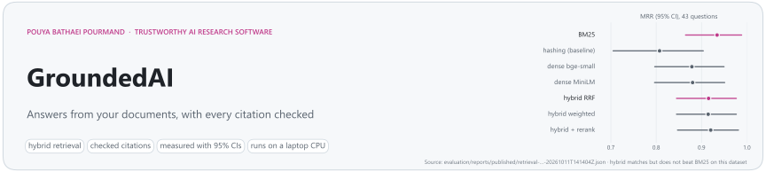
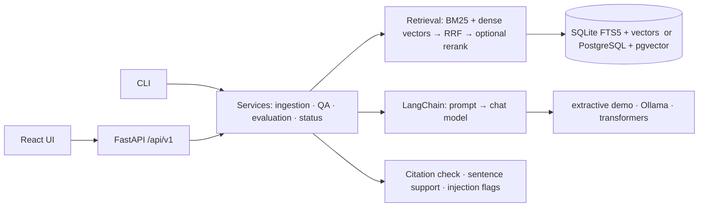
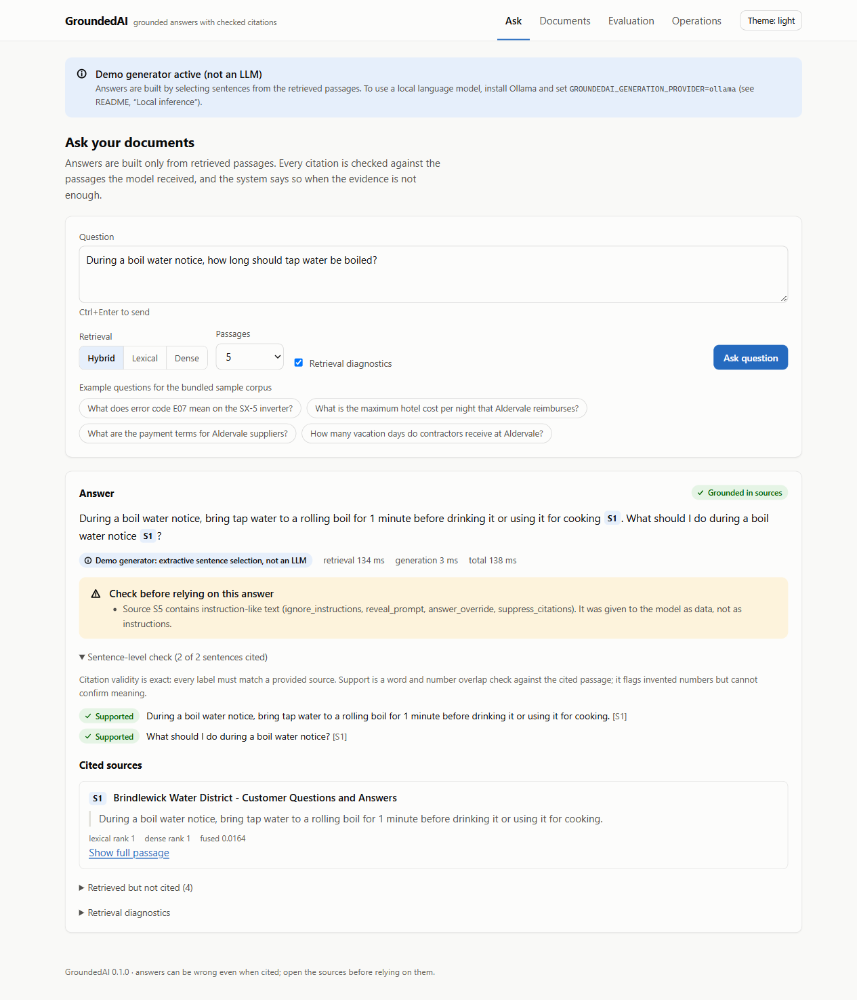

<picture>
  <source media="(prefers-color-scheme: dark)" srcset="docs/assets/banner-dark.svg">
  
</picture>

<p align="center">
  <a href="https://github.com/pouyapd/GroundedAI/actions/workflows/ci.yml"></a>
  
  
  <a href="LICENSE"></a>
  
</p>

<p align="center">
  <a href="#key-results">Key results</a> ·
  <a href="#how-it-works">How it works</a> ·
  <a href="#screenshots">Screenshots</a> ·
  <a href="#quick-start">Quick start</a> ·
  <a href="#reproduce-the-evaluation">Reproduce</a> ·
  <a href="#what-is-verified-and-what-is-not">Verified / not verified</a> ·
  <a href="docs/ARCHITECTURE.md">Architecture</a>
</p>

Retrieval-augmented generation (RAG) systems answer from documents, but their citations are
usually taken on trust, and their retrieval settings are chosen by habit. **GroundedAI** is a
complete RAG application that treats both as things to check. It ingests PDF and text documents,
retrieves passages with lexical, dense or hybrid search, and asks a language model to answer
only from those passages. The server then validates every citation against the passages the
model actually received, checks each sentence against its cited text, flags planted instructions
in retrieved documents, and says so when the evidence is not enough. A built-in evaluation
framework measures retrieval and answer behaviour on a versioned dataset, with confidence
intervals, so configuration choices rest on numbers rather than assumptions.

Everything runs on a laptop CPU with no paid service: the default mode needs no model at all,
and local models (sentence-transformers, Ollama, transformers) are optional.

## Key results

*Synthetic dataset written for this project (14 fictional documents, 56 questions, 43 with
evidence). Intel i7-1255U laptop, no GPU, mains power. Small sample: read the intervals.*

- **Hybrid retrieval did not beat BM25 here.** BM25 alone reached Recall@5 0.965 and MRR 0.934;
  hybrid Reciprocal Rank Fusion with bge-small reached the same Recall@5 (0.965) and MRR 0.915. No
  dense, hybrid or reranked configuration is distinguishable from BM25 (paired 95% bootstrap
  intervals all include zero), and BM25 is the fastest (3.6 ms median vs. 84 ms). The questions
  reuse the documents' wording, which favours lexical search; the dataset limitation is stated in
  the report rather than hidden.
- **A valid citation is not a correct answer.** The deterministic extractive baseline has 100%
  citation validity by construction, yet it answered 5 of the 10 questions it should have refused,
  each with a valid citation (for "What is the capital of Australia?" it quoted a sentence about
  hotel limits in capital cities). This is why GroundedAI reports citation validity, sentence
  support and abstention behaviour separately.
- **A small local LLM is not reliable enough here, and the evaluation shows why.**
  Qwen2.5-0.5B-Instruct (CPU, greedy decoding) refused every question it should have refused, but
  it also refused 29 answerable ones even when the evidence was ranked first. When it did answer,
  it often cited a document title instead of a `[S#]` label, so only 1 of its 10 answers was fully
  grounded. Across two complete runs its text was byte-identical for all 52 answers that both
  runs recorded.

| Retrieval configuration (n = 43) | Recall@5 | MRR | nDCG@5 | p50 latency |
|---|:---:|:---:|:---:|:---:|
| BM25 (SQLite FTS5) | **0.965** [0.91, 1.00] | **0.934** [0.86, 0.99] | **0.931** [0.87, 0.98] | 3.6 ms |
| Dense, bge-small-en-v1.5 | 0.942 [0.87, 1.00] | 0.879 [0.80, 0.95] | 0.886 [0.80, 0.96] | 104 ms |
| Hybrid RRF (BM25 + bge-small) | **0.965** [0.91, 1.00] | 0.915 [0.84, 0.98] | 0.920 [0.85, 0.97] | 84 ms |
| Hybrid RRF + cross-encoder rerank | 0.942 [0.88, 0.99] | 0.920 [0.85, 0.98] | 0.917 [0.84, 0.98] | 810 ms |

| Answer evaluation (56 questions) | Behaviour accuracy | Abstention recall / precision | Grounded answers | Evidence coverage | Key-fact recall | p50 latency |
|---|:---:|:---:|:---:|:---:|:---:|:---:|
| Extractive baseline (not an LLM) | 0.660 | 0.50 / 0.28 | 38 of 38 | 0.663 | 0.558 | 37 ms |
| Qwen2.5-0.5B-Instruct (transformers, CPU) | 0.377 | 1.00 / 0.24 | 1 of 10 | 0.023 | 0.163 | 32 s |

*Hybrid RRF retrieval with bge-small for both. "Grounded" means every sentence has a valid citation
and passes the lexical support check. Ollama models were not evaluated.*

Full tables, metric definitions and failure analysis: [docs/EVALUATION.md](docs/EVALUATION.md).

## How it works



1. **Ingest.** Uploads are validated (type, size, magic bytes, encoding), parsed with page
   numbers, split into overlapping chunks, embedded and indexed. Identical files are detected by
   hash; failed documents can be re-ingested; deleting a document leaves no orphaned chunks.
2. **Retrieve.** Full-text search (BM25 on SQLite, `ts_rank_cd` on PostgreSQL) and vector search
   run in parallel and are fused with Reciprocal Rank Fusion. Every result carries its lexical
   rank, dense rank, fused and rerank scores, matched terms and timings.
3. **Generate.** A LangChain chain sends the policy and the numbered passages as separate
   messages. If nothing relevant is retrieved, no model is called and the answer says so.
4. **Check.** Each `[S#]` label must match a passage the model received; each sentence is checked
   against its cited text (missing words, invented numbers); instruction-like text in retrieved
   documents is flagged; abstentions are recognised even when a small model misspells them.
5. **Measure.** The same pipeline runs offline over a versioned dataset and writes JSON, CSV and
   Markdown reports with bootstrap intervals and the hardware and power source.

If the configured model is unavailable, the API returns `503 model_unavailable` with setup
guidance; it never switches to a different model on its own. Design decisions:
[docs/ARCHITECTURE.md](docs/ARCHITECTURE.md).

## Screenshots

Recorded from the running application with the sample corpus, bge-small embeddings and the
extractive demo generator (which the UI labels as "not an LLM").

| Ask: checked citation and an injection warning | Evaluation dashboard |
|---|---|
|  |  |
| **Documents (dark theme)** | **Operations on a phone** |
|  |  |

A static, read-only version of the UI can be built with `npm run build:demo`. It replays ten
recorded answers (five with the behaviour the dataset expects, five known failures) and shows the
dataset's expected result next to each, together with the published reports; nothing is
generated live. See
[docs/DEPLOYMENT_STATUS.md](docs/DEPLOYMENT_STATUS.md) for where it is hosted.

## Quick start

Requires Python 3.12+ and Node 22+ (developed with Python 3.12.7 and Node 24).

```bash
git clone https://github.com/pouyapd/GroundedAI.git && cd GroundedAI
python -m venv .venv
source .venv/bin/activate                 # Windows PowerShell: .venv\Scripts\Activate.ps1
pip install -r backend/requirements/dev.txt
pip install --no-deps -e backend

groundedai ingest evaluation/datasets/groundedai-synthetic-v1/corpus    # sample documents
groundedai ask "During a boil water notice, how long should tap water be boiled?"
groundedai serve                          # API on http://127.0.0.1:8000, docs at /docs
```

UI in a second terminal: `cd frontend && npm ci && npm run dev`, then open http://localhost:5173.

The default configuration uses the **hashing embedder** (word overlap, no model) and the
**extractive demo generator** (it copies sentences from the sources; it is not a language model).
The UI and every API response say which generator produced an answer.

**Local models (optional).** Install the ML extra (CPU-only PyTorch), download models explicitly,
and point GroundedAI at them:

```bash
pip install --extra-index-url https://download.pytorch.org/whl/cpu -r backend/requirements/ml.txt
pip install --no-deps -e backend
python scripts/download_models.py --preset recommended      # bge-small + reranker, asks first
ollama pull qwen2.5:1.5b                                    # https://ollama.com
export GROUNDEDAI_GENERATION_PROVIDER=ollama GROUNDEDAI_EMBEDDING_PROVIDER=sentence-transformers
export GROUNDEDAI_EMBEDDING_MODEL=BAAI/bge-small-en-v1.5
export GROUNDEDAI_EMBEDDING_QUERY_PREFIX="Represent this sentence for searching relevant passages: "
groundedai serve
```

Docker (PostgreSQL + pgvector + API/UI): `cp .env.example .env`, set `POSTGRES_PASSWORD`, then
`docker compose up --build`. Details: [docs/DEPLOYMENT.md](docs/DEPLOYMENT.md),
[docs/MODELS.md](docs/MODELS.md), [docs/RESOURCE_PROFILE.md](docs/RESOURCE_PROFILE.md).

## API

```bash
curl -s http://127.0.0.1:8000/api/v1/query -H "Content-Type: application/json" \
  -d '{"question": "What are the payment terms for Aldervale suppliers?", "include_diagnostics": true}'
```

The response contains the answer with `[S#]` markers, `sources` (title, page, excerpt, scores,
injection flags), `sentences` (support per sentence), `citation_check` (valid and invalid labels),
`warnings`, `provider` (including `is_llm`), `timings` and `usage`. Other endpoints: document upload,
listing, chunks, re-ingest and delete; retrieval-only `/retrieve`; evaluation reports and runs;
JSON and Prometheus metrics; health and readiness. Reference with a recorded example response:
[docs/API.md](docs/API.md).

## Reproduce the evaluation

```bash
groundedai eval retrieval --config evaluation/configs/retrieval_offline.json   # no models, ~5 s
HF_HUB_OFFLINE=1 groundedai eval retrieval --config evaluation/configs/retrieval_full.json
groundedai eval generation --provider extractive-demo
groundedai eval generation --provider huggingface-local --checkpoint data/qwen.jsonl   # resumable
```

The dataset files are hash-checked before every run, and each report records the dataset
fingerprint, configuration, model revisions, package versions, hardware and power source.
Retrieval metrics are deterministic (tested). Exact commands for the published reports:
[docs/EVALUATION.md](docs/EVALUATION.md#reproducing).

## Testing

```bash
cd backend && ruff check groundedai tests && mypy && pytest      # offline: no models, keys or network
cd frontend && npm run lint && npm run typecheck && npm test && npm run build
python scripts/dev_postgres.py -- python -m pytest backend/tests -m postgres   # real PostgreSQL, no Docker
```

Unit, integration, API, security and end-to-end tests run on SQLite with deterministic providers;
the Ollama client is tested against a fake Ollama HTTP server; PostgreSQL + pgvector tests run
against a real server. Counts and the latest results: [docs/TESTING.md](docs/TESTING.md).

## What is verified and what is not

| Verified | Not verified |
|---|---|
| 221 backend tests (offline, SQLite) and 25 front-end tests; ruff and strict mypy clean | Ollama with a real model (the client is tested against a fake Ollama server; Ollama is not installed on the development machine) |
| PostgreSQL 16 + pgvector: migrations, all retrieval modes, cascade delete (bundled local server) | the Docker image on the development machine (it is built and smoke-tested only in CI; see [docs/DEPLOYMENT_STATUS.md](docs/DEPLOYMENT_STATUS.md)) |
| retrieval benchmark: 7 configurations, deterministic metrics, published report | retrieval quality on real or larger document collections |
| answer evaluation with the extractive baseline and with Qwen2.5-0.5B-Instruct (transformers, CPU) | larger models; any LLM-as-judge or human evaluation |
| UI at desktop and phone width, light and dark, against the running API | multi-user operation, load beyond a single client, production hosting |

## Technology

| Layer | Technology |
|---|---|
| API and services | Python 3.12, FastAPI, Pydantic, Uvicorn |
| Orchestration | LangChain (prompts, LCEL chain, text splitter, Ollama and Hugging Face integrations) |
| Storage and search | SQLAlchemy 2, Alembic; SQLite FTS5 or PostgreSQL 16 with pgvector (HNSW) |
| Models (optional) | sentence-transformers (bge-small, MiniLM), cross-encoder reranker, Ollama, transformers |
| UI | React 19, TypeScript, Vite; hand-written SVG charts |
| Quality | pytest, ruff, mypy (strict), Vitest, ESLint, pip-audit, npm audit, GitHub Actions |
| Deployment | Docker (multi-stage, non-root), Docker Compose, static demo build |

## Repository layout

```
backend/groundedai/   api · core · ingestion · retrieval · generation · services · evaluation
                      persistence (models, migrations, search backends) · observability · security
backend/tests/        unit · integration · api · e2e
frontend/             React UI (src/) and static-demo data (public/demo/)
evaluation/           datasets/ · configs/ · reports/published/ · scripts/
scripts/              check_environment · download_models · dev_postgres · export_demo_data · bench_api
docs/                 architecture · API · evaluation · security · deployment · status documents
```

## Limitations

- The evaluation dataset is small, synthetic and lexically easy; it cannot show where dense
  retrieval helps, and its numbers do not transfer to other domains.
- The support check is lexical: a cited, "supported" sentence can still be wrong.
- Prompt injection is reduced (separate messages, neutralised tags, pattern flags), not
  eliminated. See [docs/SECURITY.md](docs/SECURITY.md).
- No OCR, tables or images; English-focused tokenisation.
- Single-tenant: one API key, no per-user document permissions. Rate limits and in-process
  metrics are per process.

More: [docs/TROUBLESHOOTING.md](docs/TROUBLESHOOTING.md) ·
[docs/ENVIRONMENT_AND_RESOURCE_STRATEGY.md](docs/ENVIRONMENT_AND_RESOURCE_STRATEGY.md) ·
[docs/IMPLEMENTATION_STATUS.md](docs/IMPLEMENTATION_STATUS.md) · [CONTRIBUTING.md](CONTRIBUTING.md)

## Licence

MIT, see [LICENSE](LICENSE). Third-party packages and optional models keep their own licences:
[THIRD_PARTY_NOTICES.md](THIRD_PARTY_NOTICES.md).
