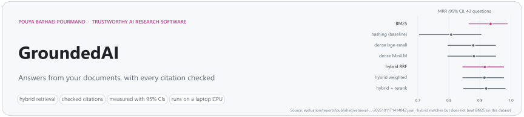
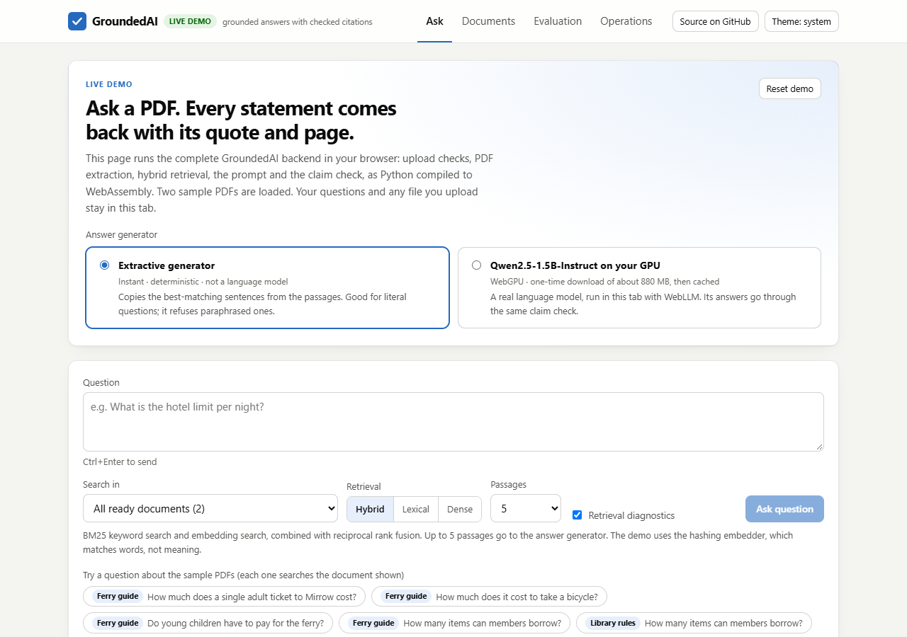
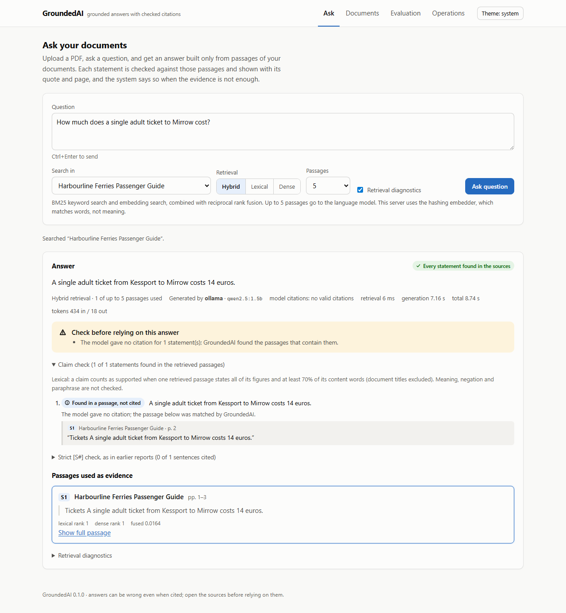
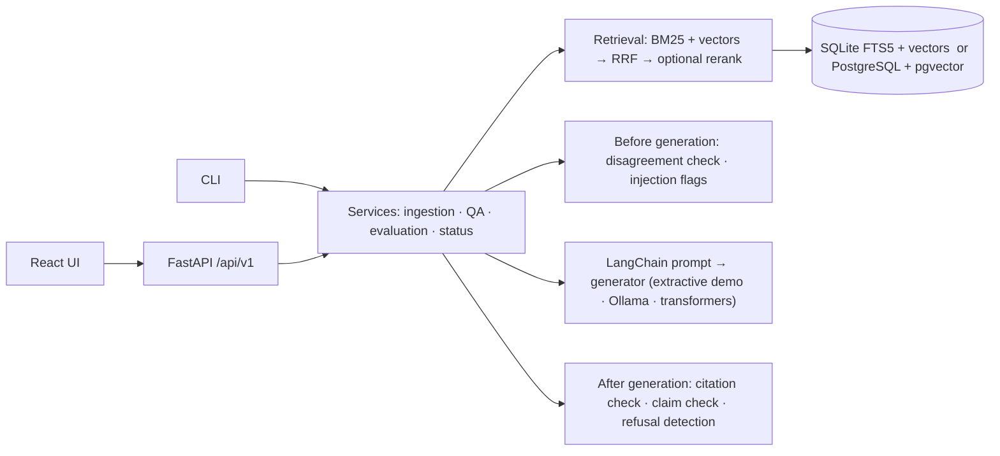

<picture>
  <source media="(prefers-color-scheme: dark)" srcset="docs/assets/banner-dark.svg">
  
</picture>

<p align="center">
  <a href="https://github.com/pouyapd/GroundedAI/actions/workflows/ci.yml"></a>
  
  
  <a href="LICENSE"></a>
  
</p>

<p align="center">
  <a href="https://pouyapd.github.io/GroundedAI/"></a>
</p>

<p align="center">
  <a href="#live-demo">Live demo</a> ·
  <a href="#what-it-does">What it does</a> ·
  <a href="#how-a-question-is-answered">Pipeline</a> ·
  <a href="#engineering-challenges">Engineering challenges</a> ·
  <a href="#results">Results</a> ·
  <a href="#limitations">Limitations</a> ·
  <a href="#future-work">Future work</a> ·
  <a href="#quick-start">Quick start</a> ·
  <a href="docs/ARCHITECTURE.md">Architecture</a>
</p>

**GroundedAI is a document-grounded question-answering system that makes the evidence behind each answer inspectable.** It combines hybrid retrieval with statement-level checks, exact source quotes and page references.

Ask questions across PDFs and other text documents. GroundedAI shows which retrieved passage matches each statement, flags missing evidence and invalid citation labels, and surfaces detected disagreements between documents. The evidence remains visible so readers can inspect the source themselves.

<p align="center">
  <a href="https://pouyapd.github.io/GroundedAI/"></a>
  <a href="https://github.com/pouyapd/GroundedAI"></a>
</p>

**What makes it useful**
- **Inspectable evidence:** statement-level status, exact supporting quote, source label and page.
- **Two generation paths:** a deterministic extractive baseline or an optional local language model.
- **Transparent checks:** citation validity, lexical evidence matching and detected source disagreements are reported separately.
- **Local-first execution:** run the full application locally, or try the browser demo without an account or server.

> **Important:** a checked citation is not a guarantee of a correct answer. The default claim checker compares words and figures, not full meaning. A statement can match a passage and still be irrelevant or misleading. Open the source before relying on an answer.

This is a research and portfolio prototype evaluated on small, author-curated datasets and a limited set of real PDFs. The results describe those test sets and should not be generalized to other domains.

**Built with:** Python 3.12, FastAPI, LangChain, SQLAlchemy + Alembic, SQLite FTS5 or
PostgreSQL + pgvector, sentence-transformers, Ollama, React 19 + TypeScript (Vite), pytest,
Playwright (browser check), Docker, GitHub Actions.

## Live demo

**[Open the live demo →](https://pouyapd.github.io/GroundedAI/)** No installation and no
account; nothing you type or upload leaves the browser tab.

- **The real backend, in your browser.** GroundedAI's Python code runs as WebAssembly
  (Pyodide): upload checks, PDF extraction, hybrid retrieval, the prompt and the claim check.
  Two synthetic sample PDFs are loaded, with example questions; you can also upload a PDF.
- **Two answer generators.** The extractive option selects sentences from retrieved passages using lexical word matching. It is deterministic, instant and is not an LLM. The optional Qwen2.5-1.5B-Instruct model generates answers in the browser through WebLLM and WebGPU (about 880 MB downloaded once, then cached). Both use the same retrieval pipeline and lexical claim check. Qwen can handle more flexible phrasing, but it can still produce incorrect or irrelevant answers ([example](docs/images/demo-llm-answer-card.png)).
- **Limits.** The first load takes about 15–60 s (about 26 MB, then cached). The demo uses a hashing embedder based on word overlap, not semantic meaning; browser data stays in the tab, and evaluation runs are unavailable. The browser's 4-bit Qwen build differs from the Ollama build used in the experiments, so outputs and timings are not directly comparable. Details:
  [docs/ONLINE_DEMO.md](docs/ONLINE_DEMO.md).

<p align="center">
  
</p>

## What it does

- **Documents.** PDF, text and Markdown uploads are validated (type, size, file header,
  encoding) and split into chunks that keep their page numbers. They are indexed for BM25
  and vector search. Unreadable files are refused with a reason.
- **Questions.** Ask across all documents or only selected ones. Hybrid retrieval (BM25 +
  embeddings, Reciprocal Rank Fusion) feeds a versioned prompt to one of three generators: a
  deterministic extractive demo (default, no model), a local model through
  [Ollama](https://ollama.com), or transformers.
- **Checks.** Before generation, conflicting passages and instruction-like text are flagged.
  After generation, citation labels are validated and every statement gets a status, a quote
  and a page.
- **Evaluation.** Versioned datasets and recorded model runs; every report records the
  hardware, model revision and power source. A 660-case suite tests the checks themselves,
  and recorded model outputs can be replayed through new checks.
- **Operations.** FastAPI with OpenAPI docs, SQLite or PostgreSQL + pgvector, Alembic
  migrations, health probes, Prometheus metrics, rate limits, optional API key, Docker.

<p align="center">
  
</p>
<p align="center"><sub>The full application run locally with qwen2.5:1.5b through Ollama (an earlier version of
the interface), on one of the sample PDFs in <code>examples/</code>. More screenshots:
<a href="docs/SCREENSHOTS.md">docs/SCREENSHOTS.md</a>.</sub></p>

## How answers are checked

Each statement gets one status. By default, the claim checker asks whether the statement's words and figures were **found** in a retrieved passage. This is lexical evidence matching, not semantic entailment, factual validation or a check that the answer addresses the question.

| Status shown | Meaning |
|---|---|
| Supported by the cited passage | the passage the model cited contains it |
| Found in a passage, not cited | another retrieved passage contains it; GroundedAI adds that source |
| Cited the wrong passage | the cited passage does not contain it, another one does (shown instead) |
| Partly found | some of it is in a passage, not enough to count as found |
| Not found in the sources | no retrieved passage contains it |

The answer can also be *Not enough evidence* or *Invalid model output* (no usable answer text),
and it can come with warnings: conflicting sources (with both quotes), invented citation labels,
and instruction-like source text. Quotes are always the document's own text, with character
offsets.

The comparison is lexical and rule-based: word forms, figures with units, dates and limit
words such as "at least". `claims-v1` is the default. `claims-v2` is opt-in
(`GROUNDEDAI_CLAIM_CHECK=claims-v2`): it judges each statement on the few sentences that carry
it, reads equivalent wordings, ordinals and names, and compares negation sentence by sentence.
It stays opt-in because its gains were measured on development data that was also used to
design it ([details](docs/RELIABILITY_V2.md)).

## Architecture



Upload → validate → extract text with page numbers → chunk → embed and index → retrieve →
check for disagreement and planted instructions → generate from numbered passages → validate
citations and check every statement → answer with quotes, pages and warnings. Design
decisions: [docs/ARCHITECTURE.md](docs/ARCHITECTURE.md).

The [live demo](docs/ONLINE_DEMO.md) runs this same application in the browser: the UI sends
its requests to a Web Worker running the Python package in Pyodide instead of a server, and the
optional model runs on the visitor's GPU with WebLLM.

## How a question is answered

| Stage | What happens | Measured (see [Results](#results)) |
|---|---|---|
| **Upload** | Type, size (10 MB), file header and encoding are checked; unreadable or scanned PDFs are refused with a reason. | Damaged, scanned, empty and oversized files refused on the live demo. |
| **Text extraction** | pypdf extracts each page's text. Text clean-up `v2` (default) expands ligatures, joins words hyphenated at line ends, and removes running headers, footers and page numbers that repeat at page edges. Each page keeps its own text, so page numbers do not move. | On 10 NIST PDFs only layout text was removed (one repeated table header too); all quotes stayed verbatim and on the right page. |
| **Chunking** | LangChain's recursive splitter, 800 characters with 120 overlap; every chunk records its first and last page and the page breaks inside it. | 400 and 1,200 characters were tested; 800 kept. |
| **Indexing and retrieval** | BM25 (SQLite FTS5, Porter stemming) and vector search (hashing embedder by default, or sentence-transformers), fused with Reciprocal Rank Fusion (k = 60); top 5 passages, optional cross-encoder reranking; PostgreSQL + pgvector as an alternative store. | Recall@5 of the evidence page .864 on the real-PDF test set. A reranker reached 1.0 on validation but was 25 to 140 times slower. |
| **Before generation** | Passages that state different values for the same thing are paired (disagreement check); instruction-like text in a passage is flagged and passed as data. | Synthetic held-out set: 12 of 16 disagreements found, 0 false alarms. Real version conflicts: 0 of 4 found. |
| **Generation** | A versioned LangChain prompt with numbered passages `[S1]`...; the model must cite or reply `INSUFFICIENT_EVIDENCE`. Generators: extractive (default, no model; copies the best-matching sentences, also matching other word forms), a local model through Ollama, transformers, or Qwen2.5-1.5B in the browser (WebLLM). | Correct answers on the real-PDF test set: extractive .725, qwen2.5:1.5b .775. |
| **After generation** | Citation labels are checked against the passages actually given; every statement is matched to the passages (lexical claim check) and gets a status, the exact quote and its page; partial answers before a refusal marker are checked too. | Invented labels (such as `S2` when only `S1` was given) are flagged. The claim check found .93 to .96 of statements. |

The claim check compares words and figures, not meaning: it cannot tell a contradiction from a
missing fact. A pretrained NLI model does much better on hand-written claims (macro-F1 .72 against
.41) and is evaluated in [`experiments/`](experiments/README.md), but it is not part of the
application yet.

## Engineering challenges

| Challenge | Engineering decision | Evidence |
|---|---|---|
| **Fluent answers the sources don't support.** Model citations can't be taken on trust. | Check every statement against every passage the model received, not only the cited one. Return the exact sentence with character offsets and its page (chunks store page breaks). | 101 of 117 statements matched to an exact quote (qwen2.5:1.5b, 56-question set). The browser test checks the quoted sentence and its page. |
| **Citations in the wrong format.** qwen2.5:1.5b used the required `[S#]` labels in 30% of answers. | Separate "malformed citation" from "unsupported statement", and attach the passage that actually contains the statement. With claims-v2, bracket-only replies become *invalid output*. | No answer cited a label that does not exist; 80% of statements were cited to the passage that contains them. 17 of 47 answers still had malformed citations. |
| **Conflicts without false alarms.** The first heuristic missed both conflict questions and paired unrelated figures. | Replace it with a disagreement check measured on 30 held-out cases written before the check. It keeps values for different dates or groups apart and ignores documents that don't mention the organisation asked about. | 12 of 16 disagreements found, 0 false alarms in 14 cases (old heuristic: 6 found, 3 false alarms). |
| **False refusals.** Early runs refused answerable questions. | Diagnose before tuning: in 27 of 29 wrong refusals the evidence had been retrieved. Prompt drafts were tested only on a separate development set, under an acceptance rule fixed in advance. The next step was a larger local model, not more prompt tuning. | 56-question set: 42 of 43 answerable questions answered, 8 of 10 should-refuse questions refused. |
| **An evaluation that could grade its own work.** One author writes the checks, data and labels. | Separate development and test splits; the test split stays out of the repository, pinned by hashes and scored once per check version. Reports record commit, settings and hardware, and recorded outputs are replayed only if the rebuild reproduces them. | `claims-v2` stays opt-in. On the test split, its 2026-10-18 version caught 69% of off-target answers (`claims-v1`: none), but accepted fewer correct paraphrases (0.63 → 0.51). |
| **Local-only inference, and broken PDFs.** | Three generators behind one interface. A missing model returns `503 model_unavailable`, never a silent fallback. Scanned PDFs get an explicit no-OCR message. | The 24-check browser journey passes with the default generator and with qwen2.5:1.5b; the default test suite needs no model or network. |

Each challenge in more detail: [docs/EVALUATION.md](docs/EVALUATION.md#engineering-challenges-in-detail).

## Results

There are two groups of results: synthetic documents (below) and
[real PDFs](#real-pdfs-november-2026). They use different documents and questions and are not
combined.

The synthetic datasets were written for this project and describe fictional organisations.
Expected behaviours and key facts were written by the project author; the reliability suite's
labels were written and reviewed by models. The numbers come from small samples on one laptop
and do not transfer to other domains.

The development set was used to develop the prompt. The 56-question evaluation set was run
once, with the frozen prompt.

| qwen2.5:1.5b via Ollama, CPU, default checks | Development set (25) | Evaluation set (56) |
|---|---|---|
| Answer questions: correct, every statement verified | 13 of 19 | 29 of 41 |
| — correct facts, not every statement verified | 3 | 10 |
| — partly correct / wrong | 1 / 0 | 0 / 1 |
| — false refusals | 2 | 1 |
| Should refuse: refused / answered anyway | 5 / 1 | 8 / 2 |
| Conflict questions: conflict stated by the model | 0 of 2 | 0 of 2 |
| Answers with malformed citations | 6 of 18 | 17 of 47 |
| Correct and fully verified with `claims-v2` (opt-in) | 14 of 19 | 26 of 41 (replay) |
| Median time per answer | 21 s | 18 s |

- **"Correct"** means the answer contains every key fact. **"Not every statement verified"**
  usually means that an extra sentence or a paraphrase was not matched to a passage. It is
  counted apart from wrong answers.
- **Conflict questions:** the development column counts its 2 among the 19 answer questions;
  the evaluation column counts them separately.
- **The `claims-v2` replay** re-checks the recorded answers without calling the model.
- **Retrieval:** on the development set, the evidence was among the 5 passages for all 19
  answerable questions, so both false refusals came from the model.
- **Retrieval (evaluation set):** on its 43 questions with evidence, BM25 alone reached
  Recall@5 0.965. Hybrid retrieval with bge-small matched it, and no configuration was
  distinguishable from BM25. The questions reuse the documents' wording, which favours
  lexical search.
- **Why the behaviours are scored separately:** a correct answer can carry an unsupported
  sentence, a supported statement can cite the wrong passage, and a refusal can be right or
  wrong. The fixes differ too (retrieval, prompt or model, claim check, conflict check), so a
  single combined score would hide which part failed.

Full tables and methodology: [docs/EVALUATION.md](docs/EVALUATION.md). Reproduce:
[docs/EVALUATION.md#reproducing](docs/EVALUATION.md#reproducing).

### Real PDFs (November 2026)

Ten public NIST publications, split by document: three for testing (two versions of SP 800-63B
and the AI Risk Management Framework), two for choosing settings, five for training data. The
53 test questions and the 108 test claims were written by hand before any run; settings were
chosen on the validation documents and each configuration was run once on the test set. One
laptop CPU, no GPU, no paid service. Differences are given with paired bootstrap 95% intervals;
with 40 answerable questions, one question is 2.5 points.

**End-to-end answers** (53 questions, 40 answerable):

| | Extractive generator | qwen2.5:1.5b (Ollama) |
|---|---|---|
| Recall@5 / MRR@10 of the evidence pages, old defaults | .807 / .753 | same retrieval |
| Correct answers, old defaults (`TEXT_CLEANUP=v1`, `EXTRACTIVE_MATCHING=exact`) | .600 | .750 |
| Correct answers, with `TEXT_CLEANUP=v2` and `EXTRACTIVE_MATCHING=prefix` (the new defaults) | .725 (+.125, CI +.025 to +.250) | .775 (+.025, CI -.100 to +.150) |
| Recall@5 / MRR@10 with those settings | .864 / .792 (+.057, CI .000 to +.136 / +.038, CI -.003 to +.094) | same retrieval |
| Should refuse (6): refused, old defaults / new defaults | 2 / 1 | 6 / 5 |
| Answers without a valid source label, old defaults | 0 of 46 | 28 of 45 |
| Quotes verbatim and on the right page | all | all |
| Version conflicts reported (4) | 0 | 0 |
| Median time per question | 0.1 s | 22 s |

**Experiments** (details, tables and limits in
[docs/RESEARCH_EVALUATION.md](docs/RESEARCH_EVALUATION.md)):

| Experiment | Result on the test set |
|---|---|
| A. PDF text clean-up and word-form matching (now the default) | More correct extractive answers (.600 to .725; the interval excludes zero). Retrieval gain small, interval touches zero. No clear change for the language model. |
| B. Fine-tuned embeddings (bge-small, 242 model-written training questions) | No measurable gain: hybrid Recall@5 -.011 (CI -.080 to +.057) against the base model; dense +.057 (CI -.045 to +.170). |
| C. LoRA fine-tuning of a small answer model | **Not completed** (CPU time). Data, code and commands are in the repository; there are no results. |
| D. Claim verifier on 108 hand-written claims (macro-F1, four labels) | Lexical check .409; pretrained NLI model (zero-shot) .723; the same model fine-tuned on rule-made pairs .740 (difference +.016, CI -.081 to +.120: not reliable). |
| D on whole answers | For the language model, the NLI check flagged 7 and 5 of 9 wrong answers (lexical check: 4 and 1) and 6 and 5 of about 30 correct ones (lexical: 2 and 5). For the extractive generator it flags no more than the lexical check: those wrong answers are real sentences that do not answer the question. |
| Deployment of the verifier | ONNX int8: 83 MB (PyTorch 270 MB), 17-19 ms per claim on the CPU (PyTorch 59-60 ms); 4 and 9 of 108 labels change. Not tested in a browser. |

- The lexical claim check cannot tell a contradiction from a missing fact (F1 0 for
  "contradicted"), and a wrong answer made of real sentences is shown as "Every statement
  found". The NLI verifier is an experiment; it is **not** part of the application.
- The live demo was tested with three of these PDFs
  ([results](docs/RESEARCH_EVALUATION.md#live-demo-test)); two bugs found in this round are
  fixed.
- Experiment A's two settings are the defaults after checks on every other question set
  ([details](docs/RESEARCH_EVALUATION.md#making-experiment-a-the-default-2026-11-13)); set
  `GROUNDEDAI_TEXT_CLEANUP=v1` and `GROUNDEDAI_EXTRACTIVE_MATCHING=exact` for the old
  behaviour. Documents indexed earlier keep their text until they are re-ingested.

## Limitations

- **The claim check is lexical, not an entailment model.** A "found" statement can still be
  wrong or beside the question, and a correct paraphrase can be "partly found". Known misses:
  - a true statement about something other than what was asked;
  - a rate whose unit differs ("£1 per minute" accepted for "£1 per 15 minutes").
- **The tested local models are small** (qwen2.5:1.5b, Qwen2.5-0.5B). qwen2.5:1.5b usually
  gives the right fact, but rarely uses the required citation format, has never stated a
  conflict, and answers some questions it should refuse.
- **The disagreement check is pattern-based.** It misses conflicts that need world knowledge,
  can pair statements about different groups when a sentence doesn't name its group, and
  never decides which source is right.
- **Version conflicts between real documents were not detected** (0 of 4 test questions on the
  2017 and 2025 versions of one NIST publication); the cause is described in
  [docs/RESEARCH_EVALUATION.md](docs/RESEARCH_EVALUATION.md#limitations).
- **The evaluation data is small.** The synthetic sets are lexically easy; the real-PDF set has
  53 questions on three documents of one publisher, labelled by one person. GroundedAI does not
  eliminate hallucinations or guarantee that an answer is correct.
- **The new defaults have known costs.** With word-form matching the extractive generator
  answered one test question it should have refused (t38), and text clean-up drops a table
  column header that repeats at the top of pages. Documents indexed before the change keep their
  old text until they are re-ingested.
- **Research results with limits.** The LoRA fine-tuning of the answer model was not completed
  (no results). The NLI verifier was measured on a CPU, including an 83 MB int8 ONNX version,
  but it has not been run in a browser and is not used by the application.
- **No OCR, tables or images;** text processing is English-focused. A quote's page is the
  page on which it starts.

## Future work

Research directions, in order of expected value:

1. **Detect conflicts between versions of a document.** No configuration found the 2017 against
   2025 differences in SP 800-63B (0 of 4). The cause is known (the check needs two shared
   question words, and treats terms such as "AAL2" as names); a fix needs its own validation
   cases, so that the 4 test questions stay a test.
2. **Use an entailment model as a second check.** A pretrained NLI model verified hand-written
   claims far better than the lexical check (macro-F1 .723 against .409) and flagged more of the
   language model's wrong answers. Next: run the 83 MB int8 ONNX model in the browser, check only
   statements the lexical check passes, and measure speed and false alarms there.
3. **Check relevance, not only support.** The extractive generator's wrong answers are real
   sentences that do not answer the question; no support check can flag them. A
   question-answer relevance score is the missing signal.
4. **Run the prepared LoRA experiment** on a GPU (data, configuration and commands are in
   [`experiments/`](experiments/README.md)), against the base model on the same test set.
5. **A larger real-document benchmark** with several publishers, a second annotator and
   agreement figures, and more local models (for example Mistral 7B through the existing Ollama
   provider) under the same settings and scoring.

## Quick start

Requirements: Python 3.12 or 3.13, Node.js 22 or later, and about 1 GB of disk without
models. Ollama is optional.

```bash
git clone https://github.com/pouyapd/GroundedAI.git && cd GroundedAI
python -m venv .venv
source .venv/bin/activate          # Windows PowerShell: .venv\Scripts\Activate.ps1
pip install -r backend/requirements/dev.txt
pip install --no-deps -e backend
cp .env.example .env               # optional: every setting has a safe default
groundedai serve                   # API on http://127.0.0.1:8000, OpenAPI docs at /docs
```

In a second terminal: `cd frontend && npm ci && npm run dev`, then open http://localhost:5173.
The SQLite database in `./data` is created and migrated at startup.

**Try it.** On **Documents**, upload `examples/harbourline-ferry-guide.pdf` and
`examples/orchard-library-rules.pdf`, then press **Ask** next to the ferry guide:

- "How much does a single adult ticket to Mirrow cost?" → 14 euros, quoted from page 2.
- "How many items can members borrow?" → not enough evidence in the ferry guide. Choose the
  library rules under **Search in** and ask again → 12 items.

**A local model.** The default extractive generator copies sentences from the passages; it is
not a language model and needs no download. To answer with a local model instead:

```bash
ollama pull qwen2.5:1.5b                          # about 1 GB; install Ollama from https://ollama.com
export GROUNDEDAI_GENERATION_PROVIDER=ollama      # PowerShell: $env:GROUNDEDAI_GENERATION_PROVIDER="ollama"
groundedai serve
```

If Ollama or the model is missing, questions return `503 model_unavailable` with the fix.
Optional semantic embeddings: [docs/MODELS.md](docs/MODELS.md). Docker Compose (PostgreSQL +
pgvector): [docs/DEPLOYMENT.md](docs/DEPLOYMENT.md). Common problems:
[docs/TROUBLESHOOTING.md](docs/TROUBLESHOOTING.md).
The Compose stack was last run end to end locally on 2026-10-13; CI builds and smoke-tests the
image and validates the Compose file on every pull request.

### Configuration

All settings use the `GROUNDEDAI_` prefix ([`.env.example`](.env.example) lists them).

| Setting | Default | Options |
|---|---|---|
| `GENERATION_PROVIDER` | `extractive-demo` | `ollama`, `huggingface-local` |
| `EXTRACTIVE_MATCHING` | `prefix` (also other forms of a question word) | `exact` |
| `OLLAMA_MODEL`, `OLLAMA_BASE_URL` | `qwen2.5:1.5b`, `http://localhost:11434` | any pulled model; a local or remote Ollama |
| `EMBEDDING_PROVIDER` | `hashing` (word overlap, no model) | `sentence-transformers`, `ollama` |
| `TEXT_CLEANUP` | `v2` (ligatures, line-break hyphens, running headers and page numbers) | `v1`: text as extracted (re-ingest after changing it) |
| `RETRIEVAL_MODE`, `TOP_K` | `hybrid`, `5` | `lexical`, `dense`; 1 to 50 |
| `CLAIM_CHECK` | `claims-v1` | `claims-v2` |
| `CONFLICT_CHECK` | `disagreement-v1` | `disagreement-v2`, `figures-v1` |
| `UNVERIFIED_ANSWERS` | `label` | `withhold`: return "not enough evidence" when no statement is found |
| `DATABASE_URL` | SQLite in `./data` | a PostgreSQL URL (pgvector) |
| `API_KEY`, `ENV` | none, `development` | required for `ENV=production` |

The HTTP API (`POST /api/v1/query` and the document, retrieval, evaluation and health
endpoints) is documented in [docs/API.md](docs/API.md); a CLI covers the same tasks.

## Testing

```bash
cd backend && ruff check groundedai tests && ruff format --check groundedai tests && mypy && pytest
cd frontend && npm run lint && npm run typecheck && npm test && npm run build
python scripts/dev_postgres.py -- python -m pytest backend/tests -m postgres   # real PostgreSQL, no Docker
python scripts/e2e_browser.py      # browser journey; needs playwright (not a project dependency)
python scripts/e2e_demo.py         # the online demo in a browser (see docs/ONLINE_DEMO.md)
```

The default suite is offline: SQLite, deterministic providers and a fake Ollama HTTP server.
No model, key or network is needed.

- **Research and live-demo check (2026-11-13):** the recorded CI run passed all 8 jobs; backend, PostgreSQL, front-end, security, Docker and browser-demo checks are detailed in [docs/TESTING.md](docs/TESTING.md). The deployed demo passed 16 of 16 browser checks, and 19 of 19 with the in-page model. The live test also checked 22 questions on three real PDFs and verified all 64 displayed quotes against their stated pages ([full report](docs/RESEARCH_EVALUATION.md#live-demo-after-deployment-2026-11-13)).
- **Earlier full run (2026-10-19):**
  - backend: 487 tests passed, plus 7 PostgreSQL tests run separately against a local
    PostgreSQL + pgvector; strict mypy and ruff clean;
  - front end: 81 tests passed;
  - browser journey: 24 of 24, with the default generator and with qwen2.5:1.5b;
  - online demo: 16 of 16 browser checks, and 19 of 19 on the live site in Chrome including
    the in-browser model (loaded, answered, answer checked against the PDF).
- **CI** (Python 3.12 and 3.13, PostgreSQL + pgvector, front end, the online demo in a browser,
  offline benchmark, dependency audit, Docker image and Compose file): all 8 jobs pass on
  `main`. The Pages workflow checks the deployed demo in a browser after each deployment.

Details: [docs/TESTING.md](docs/TESTING.md).

## Privacy and security

- **Local by default.** The server binds to `127.0.0.1`, and the only outbound connection is
  to the Ollama URL you configure. Models are never downloaded implicitly.
- **Your files stay in `./data`** (or your PostgreSQL). Deleting a document deletes its file
  and chunks. Question text is not logged unless you enable it.
- **Prompt injection is reduced, not prevented.** Documents reach the model as data, and
  instruction-like passages are flagged and never count as evidence.
- **Single-tenant.** One API key, no per-user permissions.

Details: [docs/SECURITY.md](docs/SECURITY.md).

## Repository layout

```
backend/groundedai/   api · core · ingestion · retrieval · generation · services · evaluation
                      persistence (models, migrations, search) · observability · security
backend/tests/        unit · integration · api · e2e
frontend/             React 19 + TypeScript UI (src/) and static-demo data (public/demo/)
evaluation/           datasets/ · configs/ · reports/ · reviews/
examples/             two small sample PDFs with known content
scripts/              journey and browser checks, evaluation helpers, model download
experiments/          optional research code (fine-tuning, claim verifier, ONNX); not used by the app
docs/                 architecture, API, evaluation, security, deployment, testing
```

More: [CHANGELOG.md](CHANGELOG.md) · [docs/IMPLEMENTATION_STATUS.md](docs/IMPLEMENTATION_STATUS.md) ·
[docs/RELIABILITY_AUDIT.md](docs/RELIABILITY_AUDIT.md)

## Contributing and licence

Contributions are welcome: see [CONTRIBUTING.md](CONTRIBUTING.md). Please report security
problems privately ([docs/SECURITY.md](docs/SECURITY.md)). MIT licence ([LICENSE](LICENSE));
third-party packages and models keep their own licences
([THIRD_PARTY_NOTICES.md](THIRD_PARTY_NOTICES.md)).
