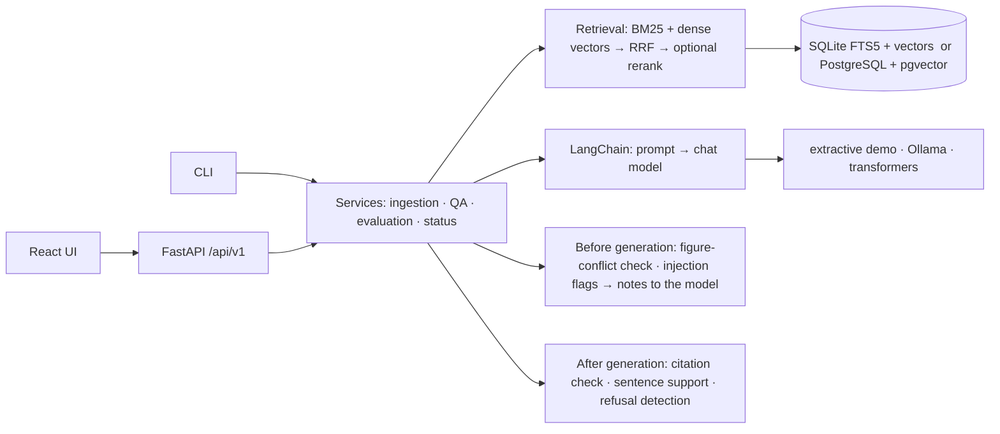
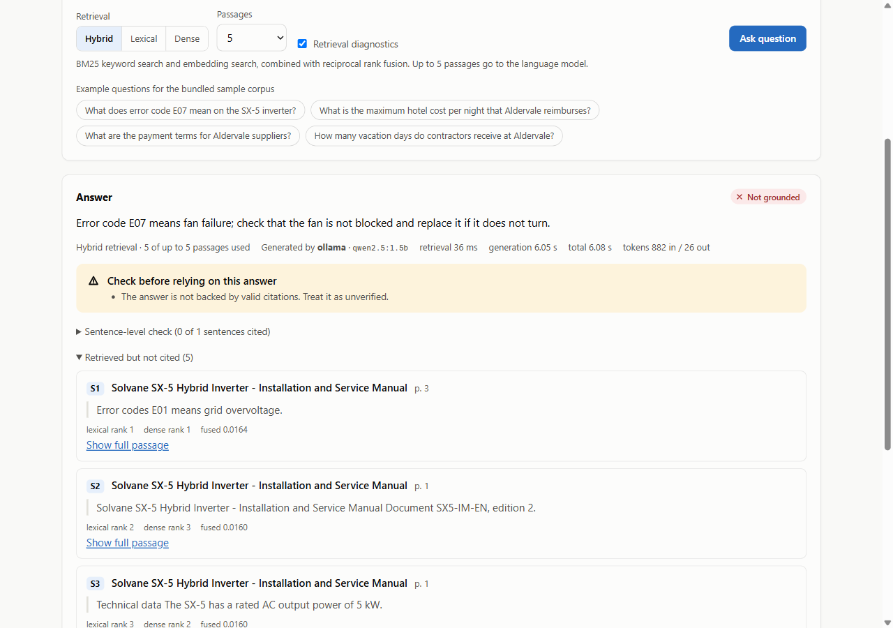

<picture>
  <source media="(prefers-color-scheme: dark)" srcset="docs/assets/banner-dark.svg">
  
</picture>

<p align="center">
  <a href="https://github.com/pouyapd/GroundedAI/actions/workflows/ci.yml"></a>
  
  
  <a href="LICENSE"></a>
  
</p>

<p align="center">
  <a href="#key-results">Key results</a> ·
  <a href="#how-it-works">How it works</a> ·
  <a href="#screenshots">Screenshots</a> ·
  <a href="#quick-start">Quick start</a> ·
  <a href="#reproduce-the-evaluation">Reproduce</a> ·
  <a href="#what-is-verified-and-what-is-not">Verified / not verified</a> ·
  <a href="docs/ARCHITECTURE.md">Architecture</a>
</p>

Retrieval-augmented generation (RAG) systems answer from documents, but their citations are
usually taken on trust, and their retrieval settings are chosen by habit. **GroundedAI** is a
complete RAG application that treats both as things to check. It ingests PDF and text documents,
retrieves passages with lexical, dense or hybrid search, and asks a language model to answer
only from those passages. The server then validates every citation against the passages the
model actually received, checks each sentence against its cited text, flags planted instructions
in retrieved documents, and says so when the evidence is not enough. A built-in evaluation
framework measures retrieval and answer behaviour on a versioned dataset, with confidence
intervals, so configuration choices rest on numbers rather than assumptions.

Everything runs on a laptop CPU with no paid service: the default mode needs no model at all,
and local models (sentence-transformers, Ollama, transformers) are optional.

## Key results

*Synthetic dataset written for this project (14 fictional documents, 56 questions, 43 with
evidence). Intel i7-1255U laptop, no GPU, mains power. Small sample: read the intervals.*

- **Hybrid retrieval did not beat BM25 here.** BM25 alone reached Recall@5 0.965 and MRR 0.934;
  hybrid Reciprocal Rank Fusion with bge-small reached the same Recall@5 (0.965) and MRR 0.915. No
  dense, hybrid or reranked configuration is distinguishable from BM25 (paired 95% bootstrap
  intervals all include zero), and BM25 is the fastest (3.6 ms median vs. 84 ms). The questions
  reuse the documents' wording, which favours lexical search; the dataset limitation is stated in
  the report rather than hidden.
- **A valid citation is not a correct answer.** The deterministic extractive baseline has 100%
  citation validity by construction, yet it answered 5 of the 10 questions it should have refused,
  each with a valid citation (for "What is the capital of Australia?" it quoted a sentence about
  hotel limits in capital cities). This is why GroundedAI reports citation validity, sentence
  support and abstention behaviour separately.
- **A revised prompt stopped wrong refusals; citations are still the weak point.** With the
  original prompt, Qwen2.5-0.5B refused 29 answerable questions although retrieval had found the
  evidence. The `answer-v2` prompt, developed on a separate 25-question development set, was then
  frozen and run once on the evaluation set. With it, the configured model `qwen2.5:1.5b`
  (Ollama, CPU) answered all 43 answerable questions and found 94% of the key facts (v1: 84% and
  77%; both differences have paired 95% intervals above zero). It also refused fewer of the
  questions it should refuse (7 of 10, v1: 9 of 10), found neither of the two conflicts, and put
  a valid `[S#]` citation on only 13 of its 49 answers, so the UI marks most of its answers
  "not grounded".

| Retrieval configuration (n = 43) | Recall@5 | MRR | nDCG@5 | p50 latency |
|---|:---:|:---:|:---:|:---:|
| BM25 (SQLite FTS5) | **0.965** [0.91, 1.00] | **0.934** [0.86, 0.99] | **0.931** [0.87, 0.98] | 3.6 ms |
| Dense, bge-small-en-v1.5 | 0.942 [0.87, 1.00] | 0.879 [0.80, 0.95] | 0.886 [0.80, 0.96] | 104 ms |
| Hybrid RRF (BM25 + bge-small) | **0.965** [0.91, 1.00] | 0.915 [0.84, 0.98] | 0.920 [0.85, 0.97] | 84 ms |
| Hybrid RRF + cross-encoder rerank | 0.942 [0.88, 0.99] | 0.920 [0.85, 0.98] | 0.917 [0.84, 0.98] | 810 ms |

| Answer evaluation (56 questions) | Correct behaviour | Answerable answered | Correct refusals | Key-fact recall | Citation format followed | p50 latency |
|---|:---:|:---:|:---:|:---:|:---:|:---:|
| Extractive baseline (not an LLM) | 0.660 | 30 of 43 | 5 of 10 | 0.558 | 100% | < 0.1 s |
| Qwen2.5-0.5B, prompt v1 (transformers) | 0.340 † | 8 of 43 | 10 of 10 | 0.163 | 13% | 32 s |
| Qwen2.5-0.5B, prompt v2 | 0.528 | 21 of 43 | 7 of 10 | 0.302 | 8% | 38 s |
| qwen2.5:1.5b, prompt v1 (Ollama, Q4_K_M) | 0.830 | 36 of 43 | 9 of 10 | 0.767 | 30% | 11 s |
| **qwen2.5:1.5b, prompt v2** (default Ollama setup) | **0.906** | **43 of 43** | 7 of 10 | **0.942** | 27% | 10 s |

*Hybrid RRF retrieval with bge-small, top 5 passages, greedy decoding, Intel i7-1255U, no GPU,
mains power. "Correct behaviour" counts an expected answer as correct even if its content is
wrong; key-fact recall measures content. Neither conflict question was handled correctly by any
configuration. † The published 0.377, re-scored with the current refusal rule.*

Full tables, metric definitions and failure analysis: [docs/EVALUATION.md](docs/EVALUATION.md).

## How it works



1. **Ingest.** Uploads are validated (type, size, magic bytes, encoding), parsed with page
   numbers, split into overlapping chunks, embedded and indexed. Identical files are detected by
   hash; failed documents can be re-ingested; deleting a document leaves no orphaned chunks.
2. **Retrieve.** Full-text search (BM25 on SQLite, `ts_rank_cd` on PostgreSQL) and vector search
   run in parallel and are fused with Reciprocal Rank Fusion. Every result carries its lexical
   rank, dense rank, fused and rerank scores, matched terms and timings.
3. **Generate.** A LangChain chain sends the policy and the numbered passages as separate
   messages, using a versioned prompt (`answer-v2` by default; `answer-v1` reproduces the earlier
   reports). Two cheap checks run first and are passed to the model as notes: passages from
   different documents that state different figures, and passages with instruction-like text.
   If nothing relevant is retrieved, no model is called and the answer says so.
4. **Check.** Each `[S#]` label must match a passage the model received; each sentence is checked
   against its cited text (missing words, invented numbers); instruction-like text in retrieved
   documents is flagged; refusals are recognised even when a small model misspells them or adds a
   citation; a reply with only citation markers is reported as invalid, not as an answer.
5. **Measure.** The same pipeline runs offline over a versioned dataset and writes JSON, CSV and
   Markdown reports with bootstrap intervals and the hardware and power source.

If the configured model is unavailable, the API returns `503 model_unavailable` with setup
guidance; it never switches to a different model on its own. Design decisions:
[docs/ARCHITECTURE.md](docs/ARCHITECTURE.md).

## Screenshots

Taken from the running application with the sample corpus and bge-small embeddings.

| Ask, with qwen2.5:1.5b through Ollama: a correct answer without a citation, flagged as unverified | Ask, extractive demo generator: checked citation and an injection warning |
|---|---|
|  |  |
| **Evaluation: qwen2.5:1.5b with the answer-v2 prompt** | **Evaluation: retrieval benchmark** |
|  |  |
| **Documents (dark theme)** | **Operations on a phone** |
|  |  |

A static, read-only version of the UI can be built with `npm run build:demo`. Ten dataset
questions (five where the extractive generator behaves as expected, five known failures) were
recorded with every retrieval mode and passage count, so the Hybrid / Lexical / Dense and
passage controls replay the recording made with exactly that setting, and each answer shows the
dataset's expected result. The published reports are included; nothing is generated live. See
[docs/DEPLOYMENT_STATUS.md](docs/DEPLOYMENT_STATUS.md) for where it is hosted and
[docs/UI_CONTROL_AUDIT.md](docs/UI_CONTROL_AUDIT.md) for how every control was checked.

## Quick start

Requires Python 3.12+ and Node 22+ (developed with Python 3.12.7 and Node 24).

```bash
git clone https://github.com/pouyapd/GroundedAI.git && cd GroundedAI
python -m venv .venv
source .venv/bin/activate                 # Windows PowerShell: .venv\Scripts\Activate.ps1
pip install -r backend/requirements/dev.txt
pip install --no-deps -e backend

groundedai ingest evaluation/datasets/groundedai-synthetic-v1/corpus    # sample documents
groundedai ask "During a boil water notice, how long should tap water be boiled?"
groundedai serve                          # API on http://127.0.0.1:8000, docs at /docs
```

UI in a second terminal: `cd frontend && npm ci && npm run dev`, then open http://localhost:5173.

The default configuration uses the **hashing embedder** (word overlap, no model) and the
**extractive demo generator** (it copies sentences from the sources; it is not a language model).
The UI and every API response say which generator produced an answer.

**Local models (optional).** Install the ML extra (CPU-only PyTorch), download models explicitly,
and point GroundedAI at them:

```bash
pip install --extra-index-url https://download.pytorch.org/whl/cpu -r backend/requirements/ml.txt
pip install --no-deps -e backend
python scripts/download_models.py --preset recommended      # bge-small + reranker, asks first
ollama pull qwen2.5:1.5b                                    # https://ollama.com, about 1 GB
export GROUNDEDAI_GENERATION_PROVIDER=ollama GROUNDEDAI_EMBEDDING_PROVIDER=sentence-transformers
export GROUNDEDAI_EMBEDDING_MODEL=BAAI/bge-small-en-v1.5
export GROUNDEDAI_EMBEDDING_QUERY_PREFIX="Represent this sentence for searching relevant passages: "
groundedai serve
```

Verified on the development laptop with Ollama 0.40.3 and `qwen2.5:1.5b` (Q4_K_M, digest
`65ec06548149`): about 1.3 GB of memory for the model runner and 10 s per answer (median) on an
i7-1255U without a GPU. The prompt can be switched with `GROUNDEDAI_PROMPT_VERSION`
(`answer-v2`, default, or `answer-v1`).

Docker (PostgreSQL + pgvector + API/UI): `cp .env.example .env`, set `POSTGRES_PASSWORD`, then
`docker compose up --build` (verified on Windows with Docker Desktop: build, health checks,
ingestion, questions in all three retrieval modes, restart with data kept, and shutdown).
Details: [docs/DEPLOYMENT.md](docs/DEPLOYMENT.md),
[docs/MODELS.md](docs/MODELS.md), [docs/RESOURCE_PROFILE.md](docs/RESOURCE_PROFILE.md).

## API

```bash
curl -s http://127.0.0.1:8000/api/v1/query -H "Content-Type: application/json" \
  -d '{"question": "What are the payment terms for Aldervale suppliers?", "include_diagnostics": true}'
```

The response contains the answer with `[S#]` markers, `sources` (title, page, excerpt, scores,
injection flags), `sentences` (support per sentence), `citation_check` (valid and invalid labels),
`warnings`, `provider` (including `is_llm`), `timings` and `usage`. Other endpoints: document upload,
listing, chunks, re-ingest and delete; retrieval-only `/retrieve`; evaluation reports and runs;
JSON and Prometheus metrics; health and readiness. Reference with a recorded example response:
[docs/API.md](docs/API.md).

## Reproduce the evaluation

```bash
groundedai eval retrieval --config evaluation/configs/retrieval_offline.json   # no models, ~5 s
HF_HUB_OFFLINE=1 groundedai eval retrieval --config evaluation/configs/retrieval_full.json
groundedai eval generation --provider extractive-demo
groundedai eval generation --provider ollama --model qwen2.5:1.5b --checkpoint data/q15.jsonl  # resumable
python scripts/compare_generation_reports.py BASE.json OTHER.json   # paired bootstrap intervals
```

The dataset files are hash-checked before every run, and each report records the dataset
fingerprint, configuration, model revisions, package versions, hardware and power source.
Retrieval metrics are deterministic (tested). Exact commands for the published reports:
[docs/EVALUATION.md](docs/EVALUATION.md#reproducing).

## Testing

```bash
cd backend && ruff check groundedai tests && mypy && pytest      # offline: no models, keys or network
cd frontend && npm run lint && npm run typecheck && npm test && npm run build
python scripts/dev_postgres.py -- python -m pytest backend/tests -m postgres   # real PostgreSQL, no Docker
```

Unit, integration, API, security and end-to-end tests run on SQLite with deterministic providers;
in the test suite the Ollama client talks to a fake Ollama HTTP server (real Ollama inference was
checked separately, see below); PostgreSQL + pgvector tests run against a real server. Counts and
the latest results: [docs/TESTING.md](docs/TESTING.md).

## What is verified and what is not

| Verified | Not verified |
|---|---|
| 266 backend tests (offline, SQLite) and 53 front-end tests; ruff and strict mypy clean (Windows and Linux targets) | CI on the latest commits: they are local and have not been pushed; CI last passed on `5cd6d3f` |
| PostgreSQL 16 + pgvector: migrations, all retrieval modes, cascade delete (bundled local server) | retrieval and answer quality on real or larger document collections |
| real Ollama inference (0.40.3, qwen2.5:1.5b) through the API, the UI and a 56-question evaluation | larger models; any LLM-as-judge or human evaluation |
| the full Docker Compose stack on Windows: build, health, ingestion, questions, restart, shutdown | the Ollama service inside Compose (`--profile llm`); Ollama ran natively instead |
| retrieval benchmark rerun reproduces every published metric and interval exactly | a statistically supported advantage of hybrid retrieval over BM25 (none was found) |
| every UI control, live and in the static demo, at desktop and phone width ([audit](docs/UI_CONTROL_AUDIT.md)) | the private claude.ai preview as rendered for a signed-in viewer (checked through its files and a local sandboxed copy) |

## Technology

| Layer | Technology |
|---|---|
| API and services | Python 3.12, FastAPI, Pydantic, Uvicorn |
| Orchestration | LangChain (prompts, LCEL chain, text splitter, Ollama and Hugging Face integrations) |
| Storage and search | SQLAlchemy 2, Alembic; SQLite FTS5 or PostgreSQL 16 with pgvector (HNSW) |
| Models (optional) | sentence-transformers (bge-small, MiniLM), cross-encoder reranker, Ollama, transformers |
| UI | React 19, TypeScript, Vite; hand-written SVG charts |
| Quality | pytest, ruff, mypy (strict), Vitest, ESLint, pip-audit, npm audit, GitHub Actions |
| Deployment | Docker (multi-stage, non-root), Docker Compose, static demo build |

## Repository layout

```
backend/groundedai/   api · core · ingestion · retrieval · generation · services · evaluation
                      persistence (models, migrations, search backends) · observability · security
backend/tests/        unit · integration · api · e2e
frontend/             React UI (src/) and static-demo data (public/demo/)
evaluation/           datasets/ · configs/ · reports/published/ · scripts/
scripts/              check_environment · download_models · dev_postgres · export_demo_data · bench_api
docs/                 architecture · API · evaluation · security · deployment · status documents
```

## Limitations

- The evaluation dataset is small, synthetic and lexically easy; it cannot show where dense
  retrieval helps, and its numbers do not transfer to other domains.
- The support check is lexical: a cited, "supported" sentence can still be wrong.
- The local models tested here are small (0.5B and 1.5B). qwen2.5:1.5b usually gives the right
  fact but rarely cites it in the required form, and it answers some questions it should refuse.
- The figure-conflict check is a weak heuristic: on the evaluation set it found neither conflict
  and raised two false alarms ([details](docs/EVALUATION.md#the-figure-conflict-check)).
- Prompt injection is reduced (separate messages, neutralised tags and labels, pattern flags,
  a note to the model), not eliminated. See [docs/SECURITY.md](docs/SECURITY.md).
- No OCR, tables or images; English-focused tokenisation.
- Single-tenant: one API key, no per-user document permissions. Rate limits and in-process
  metrics are per process.

More: [docs/TROUBLESHOOTING.md](docs/TROUBLESHOOTING.md) ·
[docs/ENVIRONMENT_AND_RESOURCE_STRATEGY.md](docs/ENVIRONMENT_AND_RESOURCE_STRATEGY.md) ·
[docs/IMPLEMENTATION_STATUS.md](docs/IMPLEMENTATION_STATUS.md) · [CONTRIBUTING.md](CONTRIBUTING.md)

## Licence

MIT, see [LICENSE](LICENSE). Third-party packages and optional models keep their own licences:
[THIRD_PARTY_NOTICES.md](THIRD_PARTY_NOTICES.md).
