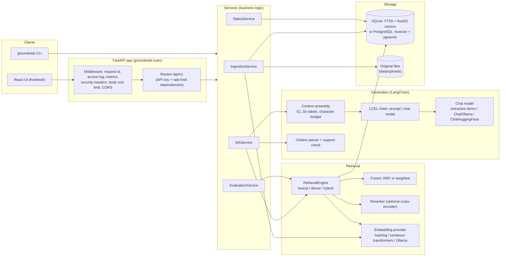
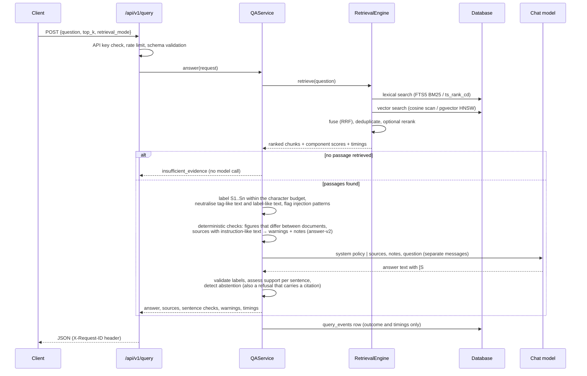

# Architecture

GroundedAI is a single Python service (FastAPI) with a React front end. It ingests documents,
indexes them for lexical and vector search, answers questions from retrieved passages with
checked citations, and evaluates its own retrieval and answers offline.

## Component overview

## Request flow: answering a question

## Modules

| Package | Responsibility |
|---|---|
| `core` | Settings (`pydantic-settings`, prefix `GROUNDEDAI_`), error types with stable codes, text utilities, network helpers |
| `ingestion` | Upload validation, PDF/text parsing, chunking with page tracking |
| `persistence` | ORM models, Alembic migrations, repositories, search backends (SQLite and PostgreSQL), file store |
| `retrieval` | Embedding providers, fusion, reranking, the retrieval engine, a LangChain `BaseRetriever` adapter |
| `generation` | Prompts, context assembly, chat-model providers, citation parsing and support checks, injection heuristics |
| `services` | Ingestion, QA, evaluation and status services; the dependency container |
| `evaluation` | Dataset loading, relevance judgments, metrics, benchmark runners, report writing |
| `observability` | JSON logging with request ids, in-process metrics, ASGI middleware |
| `security` | API-key check, token-bucket rate limiter |
| `api` | FastAPI routes, dependencies, exception handlers |

Route handlers only parse input and call a service. Services receive their collaborators
through constructors (`services/container.py`), so tests can swap the embedding model,
reranker or chat model without patching.

## Design decisions

**Two storage backends behind one protocol.** `SearchBackend` has two implementations.
SQLite (FTS5 with BM25, exact cosine scan in NumPy) runs everywhere with no server and is
used by the tests, the CLI and the benchmarks. PostgreSQL (generated `tsvector` column with a
GIN index, pgvector `vector` column with an HNSW index) is used by Docker Compose and tested
in CI and locally with a bundled Postgres. The lexical rankers differ (BM25 vs. cover density),
so published numbers name the backend that produced them.

**Hybrid retrieval with rank fusion.** Lexical and dense retrieval each return up to
`candidate_k` chunks. Reciprocal Rank Fusion combines ranks, so BM25 and cosine scores never
need calibration; weighted min-max fusion is kept as a comparison. Every returned chunk carries
its lexical rank, dense rank, fused score and (if used) rerank score, which the UI shows.

**Embeddings are tied to documents.** Each document stores the embedding model id it was
indexed with. Dense search only compares vectors from the active model; documents from another
model are excluded and the response says so. This prevents silent mixing of vector spaces after
a configuration change.

**Versioned prompts.** `generation/prompts.py` keeps `answer-v1` (used for the reports
published before 2026-10-13) next to `answer-v2` (the default since then), selected with
`GROUNDEDAI_PROMPT_VERSION`. Each evaluation report records the prompt version, a fingerprint
of the prompt text and the git commit, so a result can be traced to the exact prompt. Prompt
changes are developed on a separate development set and the evaluation set is run afterwards
(`docs/EVALUATION.md`).

**Deterministic checks before generation.** Two cheap checks run on the passages before the
model is called: sentences from different documents that state different figures about the
question's topic (`generation/conflicts.py`), and passages with instruction-like text
(`generation/safety.py`). Both become warnings in the response and, with `answer-v2`, a short
note to the model. Neither changes an answer by itself; both are heuristics with documented
blind spots (conflicts written in words, injections without the known patterns).

**Chunk-independent evaluation.** Relevance is annotated as evidence *quotes* from the
documents. At evaluation time a chunk counts as relevant if it covers at least half of a quote's
character span. Changing the chunk size does not invalidate the dataset.

**LangChain where it fits.** LangChain provides the document type, the prompt template, the
LCEL chain (`RunnablePassthrough | prompt | chat model`), the chat-model interface (Ollama,
Hugging Face, and the test/demo models) and the text splitter. Retrieval, citation validation,
metrics and business rules are plain Python and are tested without LangChain mocks. LangGraph is
not used: the workflow is a fixed pipeline with no branching agent state.

**No silent fallback.** If the configured model is unavailable the API returns `503
model_unavailable` with setup guidance. It never answers with a different model.

**Bounded generation.** A semaphore limits concurrent generations
(`GROUNDEDAI_MAX_CONCURRENT_GENERATIONS`); extra requests wait up to
`GROUNDEDAI_GENERATION_QUEUE_TIMEOUT_S` and then receive `503 server_busy`. Each generation has
a timeout (`504 model_timeout`). A slot is released only when the model call really ends, so
abandoned calls still count against the limit.

**Ingestion state machine.** `pending → processing → ready | failed`. Parsing and embedding
happen outside database transactions; chunks and the final status are written in one
transaction, so a document is never searchable with a partial set of chunks. A failed document
keeps no chunks and can be re-ingested. Documents left `pending`/`processing` by a crash are
marked `failed` (`interrupted`) at startup.

**Observability without a vendor.** Logs are JSON lines with a request id. Counters and latency
samples are kept in memory and exposed as JSON (`/api/v1/metrics`, used by the dashboard) and in
the Prometheus text format (`/api/v1/metrics/prometheus`). Question outcomes and timings (not the
question text) are stored in `query_events` so the dashboard survives restarts. OpenTelemetry
was not added: with one process and no tracing backend it would add dependencies without
adding information; the request id already correlates log lines.

## Data model

| Table | Purpose |
|---|---|
| `documents` | One row per uploaded file: content hash (unique), status, error, page/char/chunk counts, embedding model id, chunking settings, attempts |
| `chunks` | Text, character span, page span, text hash, embedding; `ON DELETE CASCADE` from documents |
| `chunks_fts` (SQLite) | FTS5 external-content index on `chunks.text`, kept in sync by triggers |
| `chunks.tsv` (PostgreSQL) | Generated `tsvector` column with a GIN index; HNSW index on `embedding` |
| `query_events` | Outcome, provider, timings, citation validity per question (no question text) |
| `evaluation_runs` | Evaluation runs started from the API, with status and full report |

Migrations live in `backend/groundedai/persistence/migrations` (Alembic). One migration file
handles both dialects. The application applies migrations at startup unless
`GROUNDEDAI_AUTO_MIGRATE=false` (the Docker image runs `groundedai migrate` in its entrypoint
instead). The pgvector column dimension is fixed when the migration runs
(`GROUNDEDAI_EMBEDDING_DIM`); the readiness check reports a mismatch.

## Dependencies

| Dependency | Why |
|---|---|
| FastAPI, Uvicorn, Pydantic, pydantic-settings | HTTP API, validation, configuration |
| SQLAlchemy, Alembic | Persistence and migrations for SQLite and PostgreSQL |
| pypdf | Pure-Python PDF text extraction (no system libraries) |
| python-multipart | Multipart uploads |
| NumPy | Vector maths for the SQLite vector search |
| langchain-core, langchain-text-splitters, langchain-ollama | Prompt/chain/model interfaces, chunking, Ollama client |
| httpx | Provider health checks |
| psycopg, pgvector (extra `postgres`) | PostgreSQL driver and vector type |
| sentence-transformers, transformers, langchain-huggingface (extra `ml`) | Local embeddings, reranker, local transformer generation |
| React, Vite, TypeScript (front end) | UI; charts are hand-written SVG, no chart library |

Exact versions are pinned in `backend/requirements/*.txt` and `frontend/package-lock.json`.
