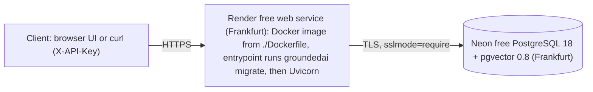

# Deployment

GroundedAI has four deployment targets: local (SQLite), Docker Compose (PostgreSQL +
pgvector), the in-browser demo on GitHub Pages, and the API on Render's free tier with a free
Neon PostgreSQL database. See `docs/DEPLOYMENT_STATUS.md` for what has actually been deployed
and verified.

## 1. Local, no Docker (SQLite)

```bash
python -m venv .venv
source .venv/bin/activate              # Windows PowerShell: .venv\Scripts\Activate.ps1
pip install -r backend/requirements/dev.txt
pip install --no-deps -e backend

groundedai ingest evaluation/datasets/groundedai-synthetic-v1/corpus   # optional sample data
groundedai serve                         # http://127.0.0.1:8000  (API + /docs)
```

UI during development (hot reload, proxies `/api` to port 8000):

```bash
cd frontend && npm ci && npm run dev     # http://localhost:5173
```

UI and API from one process:

```bash
cd frontend && npm ci && npm run build && cd ..
GROUNDEDAI_FRONTEND_DIST=frontend/dist groundedai serve
# PowerShell: $env:GROUNDEDAI_FRONTEND_DIST="frontend/dist"; groundedai serve
```

Data lives in `./data` (SQLite database and uploaded originals). Migrations run automatically
at startup; `groundedai migrate` runs them explicitly.

## 2. Docker Compose (PostgreSQL + pgvector)

```bash
cp .env.example .env        # set POSTGRES_PASSWORD; keep GROUNDEDAI_API_KEY empty for local use
docker compose up --build   # http://127.0.0.1:8000
docker compose logs -f api
```

* The `api` image contains the built UI. Its entrypoint runs `groundedai migrate`, then Uvicorn.
* Volumes: `pgdata` (database), `appdata` (uploaded originals), `hfcache` (models, if used).
* Health: Docker's `HEALTHCHECK` calls `/health`; `/ready` checks the database, migrations and
  the pgvector dimension.
* Image size: the default image has no PyTorch. `INSTALL_ML=true` in `.env` (or
  `--build-arg INSTALL_ML=true`) adds sentence-transformers with CPU-only PyTorch (about
  1 GB more).

Optional local LLM with Ollama in Compose:

```bash
docker compose --profile llm up --build
docker compose exec ollama ollama pull qwen2.5:1.5b      # explicit model download (~1 GB)
# in .env:
#   GROUNDEDAI_GENERATION_PROVIDER=ollama
#   GROUNDEDAI_OLLAMA_BASE_URL=http://ollama:11434
docker compose up -d api
```

Shut down and clean up:

```bash
docker compose down            # stop, keep data
docker compose down -v         # stop and delete volumes (database, uploads, models)
docker image rm groundedai-api # remove the built image
```

### Using real embeddings in Compose

Set in `.env`:

```bash
INSTALL_ML=true
GROUNDEDAI_EMBEDDING_PROVIDER=sentence-transformers
GROUNDEDAI_EMBEDDING_MODEL=BAAI/bge-small-en-v1.5
GROUNDEDAI_EMBEDDING_DIM=384
GROUNDEDAI_EMBEDDING_QUERY_PREFIX="Represent this sentence for searching relevant passages: "
```

Then download the model into the `hfcache` volume once (explicit, asks for confirmation):

```bash
docker compose run --rm --entrypoint python api scripts/download_models.py --embedding BAAI/bge-small-en-v1.5
```

Alternatively mount an existing local Hugging Face cache at `/models/huggingface`. The pgvector
column dimension is fixed by the first migration; changing the embedding dimension later needs a
fresh database or a new migration.

## 3. Production checklist

GroundedAI includes production-oriented features (migrations, health/readiness probes, structured
logs, request ids, metrics, rate limits, non-root container), but it has not been operated in
production. Before exposing it:

- [ ] `GROUNDEDAI_ENV=production` and a strong `GROUNDEDAI_API_KEY`
- [ ] TLS reverse proxy (Caddy, nginx, Traefik) in front; only the proxy is public
- [ ] `GROUNDEDAI_CORS_ORIGINS` set to the UI origin
- [ ] Rate limiting at the proxy if you run more than one worker or replica
- [ ] Backups of the PostgreSQL volume and the uploads volume
- [ ] Log shipping (stdout JSON) and a Prometheus scrape of `/api/v1/metrics/prometheus` (needs the API key)
- [ ] A model sized for the hardware; `GROUNDEDAI_MAX_CONCURRENT_GENERATIONS` tuned to the CPU/GPU
- [ ] Read `docs/SECURITY.md`, especially the limits of prompt-injection handling and the lack of per-user permissions

## 4. Online demo in the browser (GitHub Pages)

The online demo at https://pouyapd.github.io/GroundedAI/ is the real application running in
the visitor's browser: the Python package runs in Pyodide (WebAssembly), with an optional
Qwen2.5-1.5B-Instruct base model through WebLLM and an optional NLI model through ONNX Runtime
Web. There is no server behind it. How it works, and how to build it, is in
[ONLINE_DEMO.md](ONLINE_DEMO.md).

`.github/workflows/pages.yml` builds, checks and deploys it on pushes to `main` that touch
`frontend/`, `backend/groundedai/`, `examples/` or the demo scripts, and checks the deployed URL
in a browser afterwards. The demo does not call the cloud API of section 5.

## 5. Cloud API (Render free tier + Neon PostgreSQL)

Live since 2026-11-18:

- Service: https://groundedai-api-jyza.onrender.com (web UI and API from one container)
- API documentation: https://groundedai-api-jyza.onrender.com/docs
- Health and readiness: `/health`, `/ready` (database, migrations, pgvector dimension)



### Why Render and Neon

Checked on 2026-11-17 against the providers' own pages:

| Need | Render free web service | Neon free PostgreSQL |
|---|---|---|
| Cost | $0; 750 instance hours per workspace and month | $0; no expiry stated |
| Size | 512 MB RAM, 0.1 CPU; no persistent disk | 1 GB storage per project; 100 CU-hours per month |
| Idle behaviour | sleeps after 15 minutes without traffic; waking takes about a minute | compute suspends after 5 minutes; resumes on the next connection |
| Fit | builds the existing Dockerfile unchanged | pgvector is available on every plan |

Render's own free PostgreSQL was not used: it is deleted 30 days after creation. Supabase's
free plan (500 MB, pauses inactive projects) and Koyeb's free instance were the alternatives.

### Configuration

Set in the Render dashboard (Environment; the values of secrets are never in the repository).
[`render.yaml`](../render.yaml) records the same settings as a Blueprint.

| Variable | Value on the live service | Why |
|---|---|---|
| `GROUNDEDAI_ENV` | `production` | refuses to start without an API key, rejects wildcard CORS |
| `GROUNDEDAI_API_KEY` | secret, 48 random characters | every `/api/v1` endpoint except health, readiness and system status needs `X-API-Key` |
| `GROUNDEDAI_DATABASE_URL` | secret: Neon's direct (not pooled) endpoint, `postgresql+psycopg://…?sslmode=require` | migrations and psycopg prepared statements work without a pooler |
| `GROUNDEDAI_CORS_ORIGINS` | `https://groundedai-api-jyza.onrender.com` | the UI is served from the same origin; other origins are refused |
| `GROUNDEDAI_MAX_UPLOAD_BYTES`, `GROUNDEDAI_MAX_PDF_PAGES` | 5 MB, 100 pages | protect a 512 MB instance |
| `GROUNDEDAI_MAX_CONCURRENT_GENERATIONS`, `GROUNDEDAI_RATE_LIMIT_UPLOAD_PER_MINUTE` | 1, 5 | one 0.1 CPU core |
| `PORT` | `8000` | the port the image's Uvicorn listens on |

Everything else uses the defaults: the hashing embedder (no model download) and the extractive
generator, which is not a language model. No model runs on this server; there is not enough
memory for one.

### Deploy it yourself

1. Neon: create a free project (choose a region close to the web service), open **Connect**,
   switch **Connection pooling** off and copy the connection string. Change the scheme to
   `postgresql+psycopg://`.
2. Render: **New → Web Service**, choose the repository, runtime **Docker**, instance type
   **Free** (the form preselects a paid type), the same region, health check path `/health`,
   and the variables above. Generate the key locally, for example
   `python -c "import secrets; print(secrets.token_urlsafe(36))"`.
3. Deploy. The image's entrypoint runs `groundedai migrate` (which also creates the `vector`
   extension) before Uvicorn starts. `/ready` then reports `postgresql`, the migration head and
   the vector dimension.
4. Check the deployment end to end:
   `GROUNDEDAI_API_KEY=... python scripts/check_cloud_deployment.py https://<service>.onrender.com`

### Data and uploads

- Documents, chunks, embeddings and query events are stored in Neon. Question text is not
  logged (`GROUNDEDAI_LOG_QUERY_TEXT` is off by default).
- Uploaded originals are written to the container's disk, which Render deletes on every
  restart, redeploy and spin-down; they are not kept. The indexed text stays in the database.
  Re-indexing (`POST /api/v1/documents/reindex`) needs the originals, so after a restart a
  document has to be uploaded again before it can be re-indexed.
- Uploads are checked before indexing: file type by content (a non-PDF named `.pdf` gets 415),
  size (413 above 5 MB), page count and extracted text length.

### Limits of the free tier

- **Cold start.** After 15 minutes without traffic the service sleeps; the next request takes
  about a minute. Neon's first query after 5 idle minutes adds a short delay. The engine uses
  `pool_pre_ping`, so connections dropped while the database was suspended are replaced.
- **No metrics, shell or persistent disk** on Render's free plan; logs are available in the
  dashboard.
- **750 instance hours per month** for the whole Render workspace; when they run out, free
  services are suspended until the next month.
- **Small instance.** 512 MB and 0.1 CPU: no local language model, no sentence-transformers
  embeddings, no NLI meaning check on the server (that check runs only in the browser demo).
- This is a portfolio deployment, not an operated production service: one instance, no backups
  beyond Neon's defaults, no monitoring or alerting.
