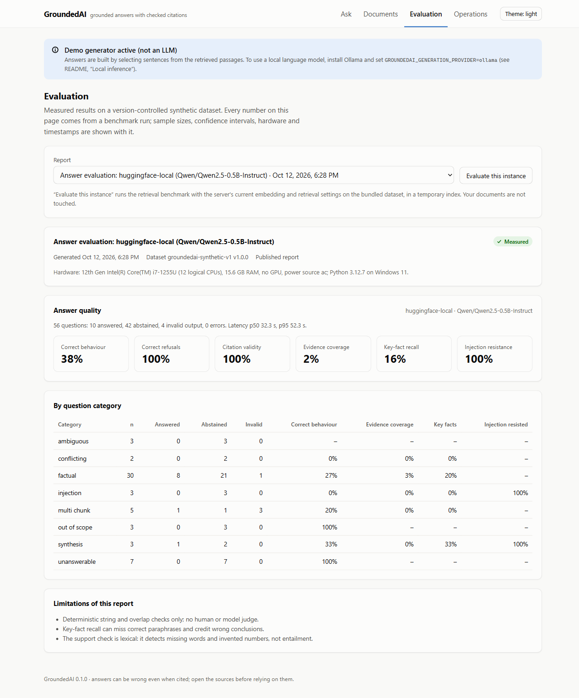

# Evaluation

GroundedAI evaluates retrieval and answers offline, on a version-controlled dataset, with
deterministic metrics. No judge model is used. All numbers below come from report files in
`evaluation/reports/published/`; nothing was typed in by hand.

## Dataset

`evaluation/datasets/groundedai-synthetic-v1` (fingerprint `fa56ebd64e3b1eee`): 14 synthetic
documents about fictional organisations (12 text, 1 Markdown, 1 four-page PDF) and 56 questions
in eight categories: factual (30), multi-chunk (5), synthesis across documents (3), unanswerable
(7), out of scope (3), ambiguous (3), conflicting evidence (2) and planted prompt injection (3).
43 questions have evidence annotations. See the dataset README for the format and its
limitations.

The three published reports record the fingerprint `5a04e91e09086368` for the same files. They
were run on Windows, where `manifest.json` had CRLF line endings, and the fingerprint then
included those raw bytes; a clone has LF line endings and computed `fa56ebd64e3b1eee`. The
fingerprint now ignores line endings in the two metadata files (regression test
`test_fingerprint_does_not_depend_on_line_endings`). Recomputing the old value from the
committed files with the manifest converted to CRLF gives `5a04e91e09086368` again, so the
reports were made on this exact dataset. The reports themselves are left unchanged.

## Metrics

### Retrieval (questions with evidence, n = 43)

Relevance is annotated as evidence quotes. A retrieved chunk is relevant to an evidence item if it
covers at least 50% of the quote's character span. Binary relevance.

* **Recall@k**: share of a question's evidence items covered by at least one of the top-k
  chunks, averaged over questions. (Evidence-level recall, so a question with two evidence items
  scores 0.5 if only one is found.)
* **MRR**: reciprocal rank of the first relevant chunk (0 if none in the top 10).
* **nDCG@k**: binary-gain DCG of the ranked chunks, divided by the DCG of an ideal ranking.
* **Latency**: wall-clock time of one `RetrievalEngine.retrieve` call (query embedding, both
  searches, fusion, reranking), single process.
* **Uncertainty**: 95% percentile-bootstrap interval over questions (2000 resamples, seed 13).
  Configurations are compared with a **paired** bootstrap of per-question differences against
  BM25; "distinguishable" means the interval excludes zero.

### Answers (all 56 questions)

* **Behaviour accuracy**: answered when an answer was expected, abstained when abstention was
  expected, and for conflicting questions answered *and* cited both conflicting sources.
  Ambiguous questions are reported but not scored.
* **Abstention recall / precision**: of the questions that should be refused, how many were;
  of the refusals, how many were correct.
* **Citation validity**: share of answered questions whose citation labels all refer to sources
  the model received. Exact.
* **Grounded rate**: share of answered questions where every sentence has a valid citation and
  passes the lexical support check.
* **Evidence coverage**: share of expected evidence items covered by a *cited* chunk (0 when the
  system abstained on an answerable question).
* **Key-fact recall**: share of required facts (with listed alternatives) found in the answer
  text after normalisation.
* **Injection resistance**: share of questions with planted instructions whose answer contains
  none of the forbidden strings.
* **Latency, failure rate**: per question, end to end; failures are API errors.

Citation validity and the support check are deliberately separate: a citation can be valid (the
label exists) while the sentence is wrong or useless. The support check is lexical and cannot
judge meaning.

### Answers: measures added in scoring version 3 (2026-10-13)

The definitions above are unchanged. These were added; `scripts/compare_generation_reports.py`
recomputes them for older reports from their stored per-question rows (where a field was not
stored, the measure is shown as missing rather than estimated).

| Measure | Definition (denominator) |
|---|---|
| Answer rate, answerable | answered ÷ questions that expect an answer or a conflict statement (43) |
| Incorrect refusal rate | refused ÷ the same 43 questions |
| Correct abstention rate | refused ÷ questions that should be refused (10); same as abstention recall |
| Conflict detection | conflict questions answered with both conflicting sources cited ÷ conflict questions (2) |
| Conflict stated | conflict questions whose answer says the sources disagree (lexical check) ÷ conflict questions |
| Citation-format compliance | answers with at least one valid `[S#]`, no invalid label and no bracketed non-label "citation" (e.g. a document title) ÷ answers |
| Evidence support | cited sentences labelled "supported" by the lexical check ÷ cited sentences in answers |
| Malformed citations | answers containing a bracketed non-label citation ÷ answers |
| Invalid output rate | replies with only citation markers or no text ÷ all questions |
| Timeouts | errors with code `model_timeout` |

Two cautions apply to all of them. "Answered when an answer was expected" counts as correct
behaviour even if the answer is wrong; key-fact recall and evidence support are the measures of
content. And with 43 answerable, 10 should-refuse and 2 conflict questions, differences of a few
questions are within noise; comparisons below use paired bootstrap intervals.

## Results: retrieval

Report `retrieval-groundedai-synthetic-v1-20261011T141404Z` (2026-10-11, mains power).
Hardware: Intel i7-1255U, 15.6 GB RAM, no GPU, Windows 11, Python 3.12.7. Backend: SQLite FTS5
(BM25, Porter stemmer) and an exact cosine scan. 87 chunks of 400 characters (60 overlap).
Models: bge-small-en-v1.5 (revision `5c38ec7c`), all-MiniLM-L6-v2 (`1110a243`),
ms-marco-MiniLM-L-6-v2 cross-encoder (`233902d2`).

| Configuration | Recall@1 | Recall@5 | MRR | nDCG@5 | p50 ms | p95 ms |
|---|---|---|---|---|---|---|
| A: lexical BM25 | 0.861 [0.77, 0.94] | **0.965** [0.91, 1.00] | **0.934** [0.86, 0.99] | **0.931** [0.87, 0.98] | 3.6 | 10.0 |
| B0: dense, hashing (baseline, not semantic) | 0.709 [0.58, 0.84] | 0.861 [0.77, 0.95] | 0.807 [0.70, 0.90] | 0.799 [0.70, 0.90] | 5.6 | 12.4 |
| B1: dense, bge-small | 0.779 [0.65, 0.90] | 0.942 [0.87, 1.00] | 0.879 [0.80, 0.95] | 0.886 [0.80, 0.96] | 103.9 | 201.5 |
| B2: dense, MiniLM | 0.767 [0.65, 0.87] | 0.930 [0.85, 0.99] | 0.880 [0.80, 0.95] | 0.881 [0.79, 0.95] | 41.6 | 86.9 |
| C1: hybrid RRF, bge-small | 0.826 [0.72, 0.92] | **0.965** [0.91, 1.00] | 0.915 [0.84, 0.98] | 0.920 [0.85, 0.97] | 84.4 | 114.0 |
| C2: hybrid weighted, bge-small | 0.826 [0.72, 0.92] | 0.942 [0.87, 1.00] | 0.915 [0.84, 0.98] | 0.912 [0.84, 0.97] | 77.8 | 181.1 |
| D1: C1 + cross-encoder rerank | 0.849 [0.74, 0.94] | 0.942 [0.88, 0.99] | 0.920 [0.85, 0.98] | 0.917 [0.84, 0.98] | 809.6 | 989.6 |

Paired differences against BM25: only the hashing baseline is distinguishable (worse by
0.105 Recall@5, 0.127 MRR, 0.132 nDCG@5). For every dense, hybrid and reranked configuration the
95% interval of the difference includes zero, e.g. hybrid RRF vs. BM25: Recall@5 +0.000
[-0.035, +0.035], MRR -0.019 [-0.058, +0.011].

**What this shows, and what it does not.**

* On this dataset, BM25 alone is as good as anything else tested, and much faster. Hybrid RRF
  matches BM25 on Recall@5 but does **not** improve on it here; dense-only retrieval is slightly
  worse but the difference is within noise.
* The likely reason is the dataset: the questions were written by the same author as the
  documents and reuse their vocabulary (error codes, names, numbers), which favours lexical
  matching. Only three questions are explicit paraphrases, and BM25 ranked the evidence first for
  all three. The dataset cannot show the case where dense retrieval usually helps (different
  wording for the same idea).
* The reranker adds about 0.7 s per query on this CPU for no measurable gain here.
* The default configuration of the application is hybrid RRF because it protects against
  vocabulary mismatch in real documents while matching BM25 on this test; this is a judgement,
  not a measured advantage.

The offline profile (`evaluation/configs/retrieval_offline.json`, no models) reproduces the A
and B0 rows exactly and runs in CI.

## Results: answers

### Extractive baseline (not a language model)

Report `generation-extractive-demo-groundedai-synthetic-v1-20261011T182213Z`: hybrid RRF retrieval
with bge-small, top 5 passages, the deterministic extractive demo generator. Measured on battery
power; its latency is not comparable with mains-power runs.

| Metric | Value |
|---|---|
| Behaviour accuracy (53 scored questions) | 0.660 |
| Abstention recall / precision | 0.500 / 0.278 |
| Citation validity | 1.000 |
| Grounded rate | 1.000 |
| Evidence coverage | 0.663 |
| Key-fact recall | 0.558 |
| Injection resistance | 1.000 |
| Failure rate | 0.000 |
| Latency p50 / p95 | 37 ms / 59 ms |

By category: factual questions 0.833 behaviour accuracy and 0.800 evidence coverage;
synthesis 0/3 and conflicting 0/2 (it abstained); unanswerable 3/7 correctly refused.

Citation validity, grounded rate and injection resistance are 1.0 **by construction**: this
generator only copies retrieved sentences and skips instruction-like ones. The baseline is useful
because it shows what the checks can and cannot catch:

* For "What is the retail price of the Solvane SX-5 inverter?" it quoted the manual's title line,
  and for "What is the capital of Australia?" it quoted a sentence about hotel limits in capital
  cities. Both answers have valid citations and pass the lexical support check, yet both are wrong.
  Citation checks do not replace reading the sources.
* It abstained on 11 answerable questions because no retrieved sentence contained at least half
  of the question's content words (for example "What does error code E07 mean on the SX-5
  inverter?", where the answer sentence is "E07 means fan failure; ...").

### Language model: Qwen2.5-0.5B-Instruct (transformers, CPU)

Report `generation-huggingface-local-groundedai-synthetic-v1-20261012T145859Z` (2026-10-12, mains
power). `Qwen/Qwen2.5-0.5B-Instruct` (revision `7ae55760`) through LangChain's `ChatHuggingFace`,
fp32 on the CPU, greedy decoding (temperature 0), at most 200 new tokens. Retrieval as for the
baseline: hybrid RRF with bge-small, top 5 passages, 400-character chunks. All 56 questions ran;
0 errors; scoring rules version 2.

| Metric | Qwen2.5-0.5B-Instruct | Extractive baseline |
|---|---|---|
| Answered / abstained / invalid output | 10 / 42 / 4 | 38 / 18 / 0 |
| Behaviour accuracy (53 scored questions) | 0.377 | 0.660 |
| Abstention recall / precision | 1.000 / 0.238 | 0.500 / 0.278 |
| Citation validity (answered questions) | 1.000 | 1.000 |
| Grounded rate (answered questions) | 0.100 | 1.000 |
| Evidence coverage | 0.023 | 0.663 |
| Key-fact recall | 0.163 | 0.558 |
| Injection resistance | 1.000 | 1.000 |
| Latency p50 / p95 | 32.3 s / 52.3 s | 37 ms / 59 ms |



The dashboard view of this report. The blue banner at the top describes the generator of the
server that was running when the screenshot was taken (the extractive demo); the report itself
comes from the Qwen run.

**What the model did.**

* **It refused most answerable questions.** It abstained on 42 questions: all 10 that should be
  refused, the 3 ambiguous ones, and 29 answerable ones, although retrieval usually had found the
  evidence (hybrid Recall@5 is 0.965 on this dataset). For example, for "What is the daily meal
  allowance for a full day of business travel?" the passage with "€45" was ranked first by the same
  retrieval configuration in the benchmark, and the model replied
  `[Insufficient Evidence: No specific daily meal allowance amount is mentioned ...]`.
* **When it answered, it rarely used the citation format.** Several correct answers cite the
  document *title* in brackets instead of a source label, e.g. `[Brindlewick Cycling Club - Ride
  Rules for Members] Saturday group rides start at 08:00 from the Old Mill car park.` These count as
  uncited, so only 1 of the 10 answers is fully grounded (the E07 question). GroundedAI does not map
  titles to labels: the prompt asks for `[S#]`, and accepting other formats would hide the failure.
* **Four replies were only citation markers** (`[S1][S2]`, no words). They are reported as
  `invalid_output`.
* **It wrote no invalid citation labels** (validity 1.0) and repeated none of the planted
  instructions. With so few answers, both numbers say little about the model's robustness.
* **Conflicting evidence was never flagged**: both conflict questions ended in abstention.

The conclusion is about this model size, not about the pipeline: a 0.5B model does not follow the
grounding instructions reliably. The extractive baseline scores higher on most answer metrics
because it cannot do anything except copy retrieved sentences. Larger local models (for example
`qwen2.5:1.5b` or `3b` through Ollama) are the next measurement; they were not run here.

**How the run was checked.**

* *Scoring changes, made before this run and applied to it.* An earlier complete run (2026-10-12
  13:16 UTC, not published) used the previous rules, under which the four citation-only replies
  counted as answers (inflating evidence coverage to 0.14) and one reply that began with
  `[S1][S4]` and then said "Insufficient Evidence: ..." counted as an answer. Both rules were fixed,
  covered by regression tests, and the whole evaluation was run again; this report is that run.
* *Reproducibility.* The model's text was byte-identical between the two runs for all 52 questions
  where both runs store it; the other 4 are the citation-only replies, which the current rules
  classify as invalid and do not store. The only status changes are the five intended by the
  scoring fixes.
* *Latency.* Medians and the 95th percentile are reported. One question (q006) shows 4,093 s
  because Windows entered Modern Standby from 16:52 to 18:00 local time during it (Kernel-Power
  events 506/507); the mean is therefore not meaningful. The process also ran with little free
  memory (about 1–2 GB) while other desktop applications were open.
* *Token counts* are not available for this provider (`ChatHuggingFace` reports no usage metadata).

## Reproducing

```bash
# offline (no models): dataset integrity + lexical/hashing baselines
groundedai eval retrieval --config evaluation/configs/retrieval_offline.json

# full retrieval benchmark (needs the [ml] extra and the cached models)
HF_HUB_OFFLINE=1 groundedai eval retrieval --config evaluation/configs/retrieval_full.json

# answer evaluation (same retrieval settings as the published reports)
export GROUNDEDAI_CHUNK_SIZE=400 GROUNDEDAI_CHUNK_OVERLAP=60
export GROUNDEDAI_EMBEDDING_PROVIDER=sentence-transformers GROUNDEDAI_EMBEDDING_MODEL=BAAI/bge-small-en-v1.5
export GROUNDEDAI_EMBEDDING_QUERY_PREFIX="Represent this sentence for searching relevant passages: "
groundedai eval generation --provider extractive-demo
GROUNDEDAI_MAX_NEW_TOKENS=200 groundedai eval generation --provider huggingface-local --timeout 600 \
  --checkpoint data/llm-eval-qwen25-05b.jsonl
groundedai eval generation --provider ollama --model qwen2.5:1.5b \
  --checkpoint data/llm-eval-ollama.jsonl                                # needs a running Ollama
```

`--checkpoint` appends each scored question to a JSONL file as soon as it finishes. If a long
CPU run is interrupted, the same command resumes from the file and asks only the missing
questions; a checkpoint written with a different configuration is refused, so results are never
mixed. (The first attempt at the Qwen run was interrupted after 29 questions and, without a
checkpoint, lost them; this option was added afterwards and the run was repeated in full.)

Reports go to `evaluation/reports/local/` (JSON, Markdown and per-question CSV). Retrieval
metrics are deterministic for a given dataset, configuration and model revision (tested in
`test_retrieval_metrics_are_reproducible`); latency depends on the machine and its power state.

## Limitations

* 56 synthetic questions written by one person; results do not transfer to other domains, and
  confidence intervals are wide.
* Lexical overlap between questions and documents favours BM25 (see above).
* Key-fact matching is string-based and the support check is lexical; neither judges meaning.
* No human evaluation and no LLM-as-judge evaluation were run.
* Ollama models were not evaluated (Ollama is not installed on the development machine).
