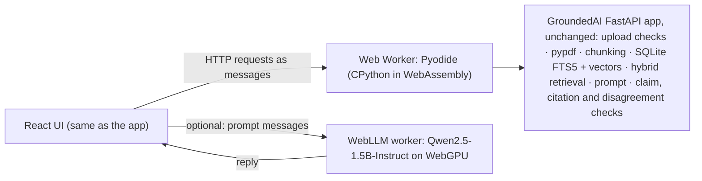

# Online demo

**Live:** https://pouyapd.github.io/GroundedAI/

The online demo is the real application, not a recording. GitHub Pages serves static files
only, and there is no server behind it: GroundedAI's Python package runs in the visitor's
browser.

## How it works



- **Backend in the browser.** The UI's normal API client (`LiveApi`) sends its requests to a Web
  Worker instead of a server ([`frontend/src/browser/`](../frontend/src/browser)). The worker
  starts Pyodide, installs the GroundedAI wheel and its pinned dependencies, and runs the
  FastAPI application through ASGI ([`groundedai/browser.py`](../backend/groundedai/browser.py)).
  WebAssembly Python has no threads, so thread-pool work runs inline
  ([`groundedai/webassembly.py`](../backend/groundedai/webassembly.py)); nothing else in the
  application changes.
- **Two generators.**
  - *Extractive* (default): the deterministic generator that copies sentences from the
    passages. It is not a language model.
  - *Qwen2.5-1.5B-Instruct on your GPU*: an optional real language model run with WebLLM on
    WebGPU. The application builds the prompt and records the exact messages; the page model
    answers; the application then checks that reply with the same claim check as any other
    model's. If the documents change between the two steps, the answer is refused.
- **Data.** Two synthetic sample PDFs from [`examples/`](../examples) are indexed at start-up.
  Visitors can upload their own files; everything stays in the tab and is gone after a reload
  or *Reset demo*.
- **Supply chain.** Pyodide comes from its pinned release on jsDelivr. The other wheels are
  served from the site itself, with versions and SHA-256 hashes pinned in
  [`frontend/browser-runtime.lock.json`](../frontend/browser-runtime.lock.json); nothing is
  resolved from PyPI at run time. The model weights come from Hugging Face
  (`mlc-ai/Qwen2.5-1.5B-Instruct-q4f16_1-MLC`), only when a visitor chooses the model.

## What differs from the full application

| | Online demo | Full application |
|---|---|---|
| Generator | extractive (default) or Qwen2.5-1.5B, 4-bit MLC build, in the browser | extractive, Ollama (any model) or transformers |
| Embeddings | hashing embedder (word overlap, no model) | hashing or sentence-transformers (bge-small) |
| Storage | SQLite in the tab's memory, reset on reload | SQLite or PostgreSQL + pgvector, persistent |
| Generation timeout | none (no threads in WebAssembly) | configurable |
| Evaluation runs | not available; the Evaluation tab shows the recorded reports | `groundedai eval …` and the API |
| First load | about 15–40 s (Python runtime, ~30 MB, cached afterwards) | instant |
| Model download | about 880 MB once, then cached by the browser | `ollama pull` |

The evaluation results in the README were measured with qwen2.5:1.5b through **Ollama**
(Q4_K_M build). The demo's model is the same base model in a different 4-bit build and
runtime, so its answers can differ; no evaluation was run on it.

## Requirements

- Any current browser with WebAssembly for the extractive generator, desktop or phone.
- For the language model: WebGPU (current Chrome or Edge on desktop; some other browsers and
  most phones do not offer it), about 2 GB of free GPU memory, and the one-time download. The
  page checks for WebGPU and disables the option, with the reason, when it is missing.

## Build and test locally

```bash
python scripts/build_browser_runtime.py build     # pinned wheels + GroundedAI wheel + samples
cd frontend && npm ci && npm run build:browser && cd ..
python scripts/e2e_demo.py                        # serves frontend/dist under /GroundedAI/
python scripts/e2e_demo.py --llm --channel chrome --profile .cache/demo-browser   # + model
python scripts/e2e_demo.py --url https://pouyapd.github.io/GroundedAI/            # deployed
```

`e2e_demo.py` needs `playwright` with Chromium (not a project dependency). On Windows,
Playwright's own Chromium lacks the Direct3D shader compiler that WebGPU needs, so the model
check uses the installed Chrome (`--channel chrome`).

The Pages workflow ([`.github/workflows/pages.yml`](../.github/workflows/pages.yml)) builds the
site, runs `e2e_demo.py` on it, deploys it, and runs `e2e_demo.py` against the deployed URL.
CI runners have no GPU, so the model check runs only locally.
